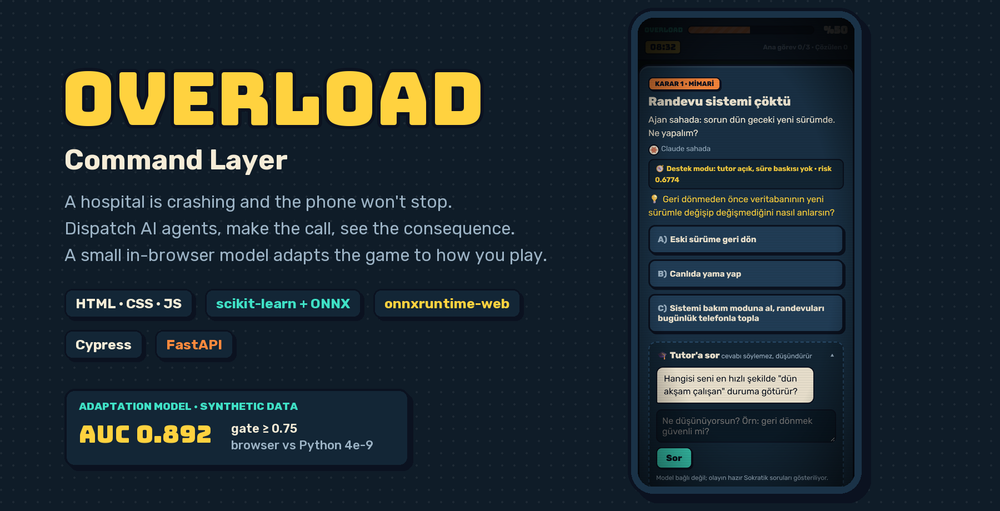
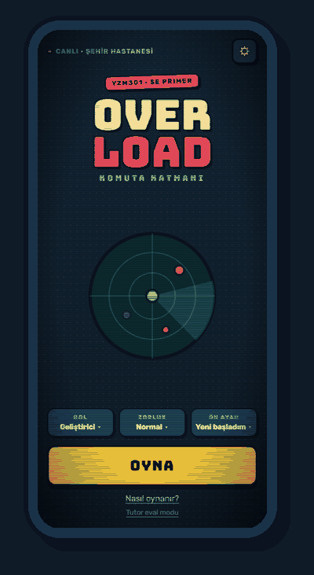
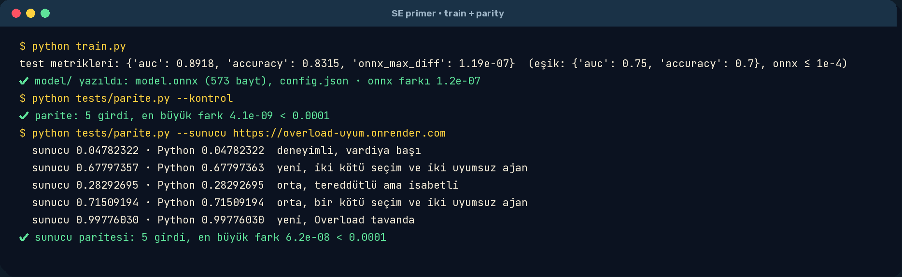
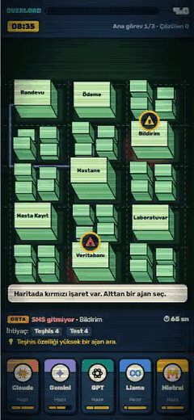
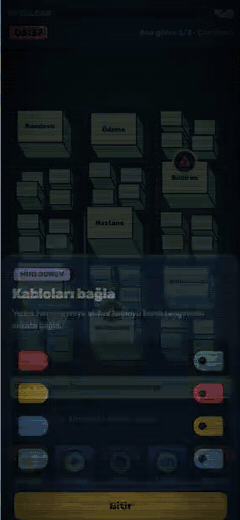
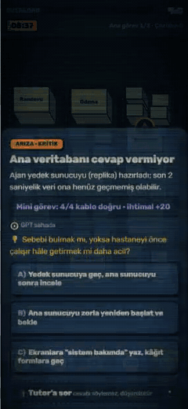
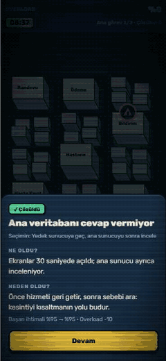
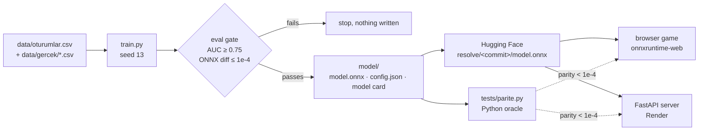
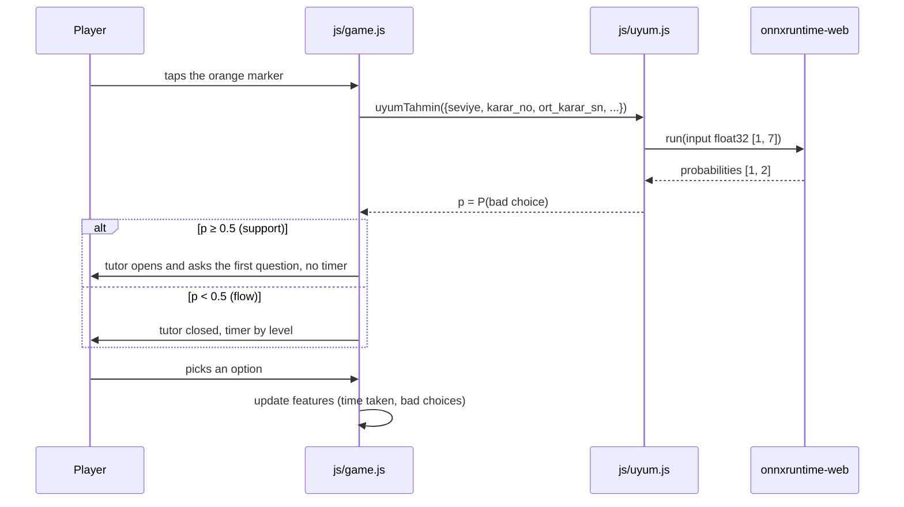

<p align="center">
  
</p>

<p align="center">
  <a href="#demo">Demo</a> · <a href="#what-it-does">What it does</a> · <a href="#how-it-works">How it works</a> · <a href="#the-adaptation-model-v2">Adaptation model</a> · <a href="#run-it">Run it</a> · <a href="#deliverables">Deliverables</a> · <a href="#türkçe">Türkçe</a>
</p>

Overload is a mobile decision game for a software engineering course (YZM301 · SE Primer). A hospital's IT is falling apart and you are the command layer: you send AI agents into the field, pick what they do, and see the consequence right away. In v2 a small model trained on gameplay behaviour runs in the browser and changes how the game treats you.

**Play:** [huseyinbaranisik.github.io/OverLoad](https://huseyinbaranisik.github.io/OverLoad/) · **Model:** [huggingface.co/huseyinbaran/overload-uyum](https://huggingface.co/huseyinbaran/overload-uyum) · **Server:** [overload-uyum.onrender.com/health](https://overload-uyum.onrender.com/health) · **v1 demo video:** [YouTube](https://youtu.be/fxyTmpdYf20)

## Demo

<p align="center"></p>

<p align="center"><sub><b>Fig. 2</b> · A real recording of the live build (<a href="tools/record_demo.py"><code>tools/record_demo.py</code></a>, deterministic <code>?test</code> mode). Two bad choices in a row, then the model's risk passes 0.5 and the tutor opens on its own.</sub></p>

<p align="center"></p>

<p align="center"><sub><b>Fig. 3</b> · Real output: training with the eval gate, the Python oracle against the stored references, and the live Render server against the same five inputs.</sub></p>

<table>
  <tr>
    <td align="center" width="25%"><br><sub>Send an agent</sub></td>
    <td align="center" width="25%"><br><sub>Mini task: cables</sub></td>
    <td align="center" width="25%"><br><sub>Decide: what happened, and why</sub></td>
    <td align="center" width="25%"><br><sub>End of shift</sub></td>
  </tr>
</table>
<p align="center"><sub><b>Fig. 4</b> · Gameplay moments, recorded from v1 with Cypress.</sub></p>

## What it does

<table>
  <tr><td><b>Shift</b></td><td>08:00 to 17:00 in about seven real minutes. Three main calls: the appointment system crashes, SMS stops going out, an outside company asks for patient logs.</td></tr>
  <tr><td><b>Agents</b></td><td>Claude, Gemini, GPT, Llama and Mistral, each with its own strengths, energy and cooldown. Sending the wrong one makes the system strain.</td></tr>
  <tr><td><b>Overload</b></td><td>Waiting incidents and bad decisions fill the bar; at 100% the system goes down.</td></tr>
  <tr><td><b>Incidents</b></td><td>14 random incidents (DDoS, a leaked backup, phishing…). The longer they wait, the bigger the marker grows, until it explodes.</td></tr>
  <tr><td><b>Mini tasks</b></td><td>Critical incidents ask you to match cables or build a terminal command first.</td></tr>
  <tr><td><b>Decisions</b></td><td>Three or four options in a new order every time; the expert option only appears when the right agent is on site.</td></tr>
  <tr><td><b>Endings</b></td><td>Good shift · KVKK (data protection) breach · system down · day over.</td></tr>
  <tr><td><b>Socratic tutor</b></td><td>A Gemini tutor in every decision window gives hints and asks questions but never says which option is right. In the project's eval it gave the answer away in 0 of 17 cases (<a href="eval/REPORT.md"><code>eval/REPORT.md</code></a>, as reported there; not re-run for this README).</td></tr>
  <tr><td><b>Adaptation (v2)</b></td><td>A small model reads how you have played this shift and switches between <i>flow</i> and <i>support</i> mode.</td></tr>
</table>

## How it works

The game is plain HTML, CSS and JavaScript with no build step. Version 2 adds a model pipeline next to it: training happens locally, Hugging Face only hosts the file, and every consumer downloads the same file from a pinned commit.



When a decision window opens, the game builds seven features from the current shift and asks the model:



## The adaptation model (v2)

The question the model answers: *when a decision window opens, how likely is this player to slide into the tempting but bad option?* Inputs are the player's behaviour in this shift: hesitation (average decision time), earlier bad choices, sending agents unsuited to the job, Overload, questions asked to the tutor, level and decision number.

<table>
  <tr><td><b>Spec</b></td><td><a href="spec.md"><code>spec.md</code> §12</a>: task, threshold (AUC ≥ 0.75), acceptance examples AE-9, AE-10, AE-11. Committed <b>before</b> training (<code>fb07e3c</code>).</td></tr>
  <tr><td><b>Data</b></td><td><a href="data/oturumlar.csv"><code>data/oturumlar.csv</code></a>: 400 sessions, 2183 decisions, all <code>kaynak = sentetik</code>. Dictionary: <a href="data/SOZLUK.md"><code>data/SOZLUK.md</code></a>.</td></tr>
  <tr><td><b>Collecting real data</b></td><td>Open <a href="https://huseyinbaranisik.github.io/OverLoad/?veri">the game with <code>?veri</code></a>. The model runs in shadow (it does not change the game), each decision is one row with <code>kaynak = gercek</code>, and the end screen downloads a CSV. No name, device, time or location is recorded.</td></tr>
  <tr><td><b>Training</b></td><td><a href="train.py"><code>train.py</code></a>: one command, seed 13, stops with an error below the threshold.</td></tr>
  <tr><td><b>Artefact</b></td><td><a href="model/"><code>model/</code></a>: <code>model.onnx</code> (573 bytes), <code>config.json</code> (the contract), <a href="model/README.md">model card</a>.</td></tr>
  <tr><td><b>Release</b></td><td><a href="https://huggingface.co/huseyinbaran/overload-uyum">Hugging Face</a>, downloaded from a pinned commit. <a href="RELEASE.md"><code>RELEASE.md</code></a>: rollback, shadow, canary and progressive rollout, trade-off matrix.</td></tr>
  <tr><td><b>Tests</b></td><td><a href="tests/parite.py"><code>tests/parite.py</code></a> (Python oracle) and <a href="cypress/e2e/model.cy.js"><code>cypress/e2e/model.cy.js</code></a>: browser vs Python under 1e-4, AE-9, AE-10, data mode. The 14 v1 tests still pass.</td></tr>
  <tr><td><b>Server (bonus)</b></td><td><a href="server/app.py"><code>server/app.py</code></a>: FastAPI and <code>onnxruntime</code>, same pinned model, <code>POST /predict</code>, deployed with <a href="render.yaml"><code>render.yaml</code></a>.</td></tr>
  <tr><td><b>Exam design</b></td><td><a href="SINAV_TASARIMI.md"><code>SINAV_TASARIMI.md</code></a></td></tr>
</table>

Measured for this README (Fig. 3, and Cypress on 4 November 2026):

| Check | Result |
|---|---|
| Test AUC / accuracy (threshold 0.75 / 0.70) | 0.8918 / 0.8315 |
| ONNX vs scikit-learn | 1.2e-7 |
| Browser (onnxruntime-web) vs Python oracle, 5 inputs | 4.1e-9 |
| Live Render server vs Python oracle, 5 inputs | 6.2e-8 |
| Cypress: 6 paths + 8 acceptance + 4 model tests | 18 / 18 |

> [!WARNING]
> **The data is synthetic.** No real player sessions are in this model yet, so the high AUC is optimistic: the model mostly recovers the rule that generated the data. Generator: [`data/uret.py`](data/uret.py), seed 13. Each session has a hidden skill score drawn from N(−0.6 / 0 / +0.6, 1) by level, and the chance of a bad choice is `σ(−1.3 − 0.9·skill + 0.55·earlier_bad + 0.35·unsuited_agent + 0.02·(overload−30) + 0.04·(avg_decision_s−20) − 0.3·min(tutor_questions, 3))`. Limits are in the [model card](model/README.md).

### Why this way?

| Decision | Why |
|---|---|
| Run the model in the browser | The game already runs there, the model is 573 bytes and holds nothing secret, and the player's behaviour never leaves the device. Full matrix in [`RELEASE.md`](RELEASE.md). |
| Pinned Hugging Face commit, not `main` | Uploading a new model cannot silently change the live game; rolling back is changing one hash. |
| Shadow mode for data collection | If the model changed the game while collecting, the data would partly measure the model's own decisions. |
| No token score, no 3D city, no accounts | Energy and cooldown already teach resource management; a 3D city is heavy on phones and hard to test; a leaderboard fights a tutor that never gives answers. |

## Run it

```bash
uv venv --python 3.12 .venv && uv pip install --python .venv -r requirements.txt
.venv/Scripts/python data/uret.py && .venv/Scripts/python train.py && .venv/Scripts/python tests/parite.py --kontrol
npm install && npm run test:e2e
```

The game: serve `index.html` locally (for example `python -m http.server`). On macOS and Linux use `.venv/bin/` instead of `.venv/Scripts/`. The server: `uvicorn server.app:app --port 8200`, then `tests/parite.py --sunucu http://localhost:8200`. The README figures: `tools/record_demo.py`, then `tools/render_figures.py`.

## Deliverables

| Week | Item | Where |
|---|---|---|
| v1 | Spec | [`spec.md`](spec.md): scenario, rules, 8 acceptance examples, flow |
| v1 | Design | [`design/`](design/) Stitch screens · [`DESIGN.md`](DESIGN.md) · [Stitch project](https://stitch.withgoogle.com/projects/8956004343299476746) |
| v1 | App | [AI Studio](https://ai.studio/apps/5bc7e967-3e3e-4ac6-8201-5ffd4aa2acdb) (v1, no model) · source [`aistudio/`](aistudio/) |
| v1 | Tutor eval | [`eval/`](eval/): 20 cases, raw answers, labels, report |
| v1 | Cypress + demo | [`cypress/`](cypress/) · [video](https://youtu.be/fxyTmpdYf20) |
| v2 | Model, release, tests | [The adaptation model](#the-adaptation-model-v2) above · live v2 game on [GitHub Pages](https://huseyinbaranisik.github.io/OverLoad/) |

## AI tools

The declaration is kept in the student's own words in the Turkish section below ([Yapay zekâ araçları beyanı](#yapay-zekâ-araçları-beyanı)).

## Credits

- The eval method was inspired by Safiye's [dispatch-desk](https://github.com/sayko89/dispatch-desk), built for the same assignment.
- Course starter repository: [seyyah/huggingface-hello-web](https://github.com/seyyah/huggingface-hello-web).
- Fonts in the figures: [Bungee](https://fonts.google.com/specimen/Bungee), [Rubik](https://fonts.google.com/specimen/Rubik) and [JetBrains Mono](https://fonts.google.com/specimen/JetBrains+Mono), all SIL Open Font License ([`tools/fonts/`](tools/fonts/)).
- The city, people and numbers in the game are fiction.

---

## Türkçe

Overload, bir yazılım mühendisliği dersi (YZM301 · SE Primer) için yapılmış mobil bir karar oyunu. Hastanenin bilişim sistemleri çöküyor ve sen Komuta Katmanı'sın: sahaya yapay zekâ ajanları gönderiyor, ne yapacaklarını seçiyor ve sonucunu hemen görüyorsun. v2'de oyuncu davranışıyla eğitilmiş küçük bir model tarayıcıda çalışıyor ve oyunun sana nasıl davrandığını değiştiriyor.

**Oyna:** [huseyinbaranisik.github.io/OverLoad](https://huseyinbaranisik.github.io/OverLoad/) · **Model:** [huggingface.co/huseyinbaran/overload-uyum](https://huggingface.co/huseyinbaran/overload-uyum) · **Sunucu:** [overload-uyum.onrender.com/health](https://overload-uyum.onrender.com/health) · **v1 demo videosu:** [YouTube](https://youtu.be/fxyTmpdYf20)

### Demo

Şekil 2, canlı sürümün gerçek kaydı ([`tools/record_demo.py`](tools/record_demo.py), deterministik `?test` modu). Oyuncu art arda iki kez cazip ama kötü seçeneği seçiyor. Üçüncü kararda modelin riski 0,5'i geçiyor ve tutor kendiliğinden açılıyor. Şekil 3, eval kapılı eğitimin, Python kahininin ve canlı Render sunucusunun aynı beş girdideki gerçek çıktısı.

### Ne yapıyor?

<table>
  <tr><td><b>Vardiya</b></td><td>08:00–17:00, gerçekte yaklaşık 7 dakika. Üç ana çağrı: randevu sistemi çöker, SMS gitmez, dış firma hasta loglarını ister.</td></tr>
  <tr><td><b>Ajanlar</b></td><td>Claude, Gemini, GPT, Llama ve Mistral. Her birinin güçlü olduğu alan, enerjisi ve soğuma süresi farklı. Yanlış ajanı göndermek sistemi zorlar.</td></tr>
  <tr><td><b>Overload</b></td><td>Bekleyen olaylar ve kötü kararlar barı doldurur; %100'de sistem çöker.</td></tr>
  <tr><td><b>Olaylar</b></td><td>14 rastgele olay (DDoS, sızan yedek, oltalama…). Beklettikçe işaret büyür, sonunda patlar.</td></tr>
  <tr><td><b>Mini görevler</b></td><td>Kritik olaylarda önce kablo bağlama ya da terminal komutu kurma.</td></tr>
  <tr><td><b>Kararlar</b></td><td>3–4 seçenek, sıra her seferinde karışık; uzman seçeneği yalnızca doğru ajan sahadaysa çıkar.</td></tr>
  <tr><td><b>Sonlar</b></td><td>İyi nöbet · KVKK ihlali · sistem çöktü · gün bitti.</td></tr>
  <tr><td><b>Sokratik tutor</b></td><td>Her karar penceresindeki Gemini tutor ipucu verir, soru sorar ama hangi seçeneğin doğru olduğunu söylemez. Projenin eval'inde 17 vakanın 0'ında cevabı ele verdi (<a href="eval/REPORT.md"><code>eval/REPORT.md</code></a>; bu README için yeniden çalıştırılmadı).</td></tr>
  <tr><td><b>Uyum (v2)</b></td><td>Küçük bir model bu vardiyada nasıl oynadığını okur ve <i>akış</i> ile <i>destek</i> modu arasında geçiş yapar.</td></tr>
</table>

### Nasıl çalışıyor?

Oyun derleme adımı olmayan düz HTML, CSS ve JavaScript. v2 yanına bir model hattı ekliyor: eğitim yerelde yapılıyor, Hugging Face yalnızca dosyayı barındırıyor ve her tüketici aynı dosyayı sabit bir commit'ten indiriyor (yukarıdaki iki diyagram). Karar penceresi açılınca oyun o vardiyadan 7 özellik çıkarıp modele sorar. p ≥ 0,5 ise destek modu: tutor açılır ve ilk soruyu kendisi sorar, süre sayacı kalkar. p < 0,5 ise akış modu: tutor kapalı, sayaç seviyeye göre kalır.

### Uyum modeli (v2)

Modelin cevapladığı soru: *karar penceresi açılırken bu oyuncunun cazip ama kötü seçeneğe kayma olasılığı ne?* Girdiler oyuncunun bu vardiyadaki davranışı: tereddüt (ortalama karar süresi), önceki kötü seçimler, işe uygun olmayan ajan gönderme, Overload, tutor'a soru sayısı, seviye ve kaçıncı karar olduğu.

- **Spec:** [`spec.md` §12](spec.md): görev, eşik (AUC ≥ 0,75), AE-9/10/11. Eğitimden **önce** commit'lendi (`fb07e3c`).
- **Veri:** [`data/oturumlar.csv`](data/oturumlar.csv): 400 oturum, 2183 karar, hepsi `kaynak = sentetik`. Sözlük: [`data/SOZLUK.md`](data/SOZLUK.md).
- **Gerçek veri toplama:** [Oyunu `?veri` ile aç](https://huseyinbaranisik.github.io/OverLoad/?veri). Model gölgede çalışır (oyunu değiştirmez), her karar `kaynak = gercek` olan bir satırdır, son ekranda CSV iner. Ad, cihaz, saat ya da konum kaydedilmez.
- **Eğitim:** [`train.py`](train.py): tek komut, tohum 13, eşik altında hata verip durur.
- **Artefakt:** [`model/`](model/): `model.onnx` (573 bayt), `config.json` (sözleşme), [model kartı](model/README.md).
- **Yayın:** [Hugging Face](https://huggingface.co/huseyinbaran/overload-uyum), sabit commit'ten iner. [`RELEASE.md`](RELEASE.md): rollback, gölge, kanarya ve aşamalı geçiş, ödünleşim matrisi.
- **Testler:** [`tests/parite.py`](tests/parite.py) (Python kahini) ve [`cypress/e2e/model.cy.js`](cypress/e2e/model.cy.js): tarayıcı ↔ Python farkı 1e-4'ün altında, AE-9, AE-10, veri modu. v1'in 14 testi hâlâ geçiyor.
- **Sunucu (bonus):** [`server/app.py`](server/app.py): FastAPI ve `onnxruntime`, aynı sabit model, `POST /predict`, [`render.yaml`](render.yaml) ile Render'da.
- **Sınav tasarımı:** [`SINAV_TASARIMI.md`](SINAV_TASARIMI.md)

Bu README için ölçülenler (Şekil 3 ve 4 Kasım 2026'daki Cypress çalıştırması): test AUC 0,8918, doğruluk 0,8315 (eşik 0,75 / 0,70) · ONNX ↔ scikit-learn 1,2e-7 · tarayıcı ↔ Python 4,1e-9 · canlı Render sunucusu ↔ Python 6,2e-8 · Cypress 18 / 18.

> [!WARNING]
> **Veri sentetiktir.** Bu modelde henüz gerçek oyuncu oturumu yok; yüksek AUC bu yüzden iyimser: model büyük ölçüde veriyi üreten kuralı geri buluyor. Üretici: [`data/uret.py`](data/uret.py), tohum 13. Her oturumun seviyeye göre N(−0,6 / 0 / +0,6, 1)'den çekilen gizli bir beceri puanı vardır; kötü seçim olasılığı `σ(−1,3 − 0,9·beceri + 0,55·önceki_kötü + 0,35·uyumsuz_ajan + 0,02·(overload−30) + 0,04·(ort_karar_sn−20) − 0,3·min(tutor_soru,3))`. Sınırlar [model kartında](model/README.md).

### Neden böyle?

| Karar | Neden |
|---|---|
| Model tarayıcıda | Oyun zaten orada, model 573 bayt ve gizli bir şey içermiyor, oyuncunun davranışı cihazdan çıkmıyor. Tam matris [`RELEASE.md`](RELEASE.md)'de. |
| `main` değil sabit commit | Hub'a yeni model yüklemek canlı oyunu sessizce değiştiremez; geri almak tek bir hash'i değiştirmek. |
| Veri toplarken gölge modu | Model veri toplarken oyunu değiştirseydi veri kısmen modelin kendi kararlarını ölçerdi. |
| Token puanı, 3D şehir ve hesap yok | Enerji ve soğuma zaten kaynak yönetimini öğretiyor; 3D şehir telefonda ağır ve test etmesi zor; skor tablosu cevabı söylemeyen tutor'la çelişir. |

### Kurulum

```bash
uv venv --python 3.12 .venv && uv pip install --python .venv -r requirements.txt
.venv/Scripts/python data/uret.py && .venv/Scripts/python train.py && .venv/Scripts/python tests/parite.py --kontrol
npm install && npm run test:e2e
```

Oyun: `index.html`'i bir yerel sunucuyla aç (ör. `python -m http.server`). macOS/Linux'ta `.venv/Scripts/` yerine `.venv/bin/`. Sunucu: `uvicorn server.app:app --port 8200`, ardından `tests/parite.py --sunucu http://localhost:8200`. README figürleri: önce `tools/record_demo.py`, sonra `tools/render_figures.py`.

### Yapay zekâ araçları beyanı

- **Claude Code (Opus):** spec §12 taslağı, sentetik veri üreteci, `train.py`, ONNX aktarımı, `js/uyum.js`, parite ve Cypress testleri, `RELEASE.md` ve `SINAV_TASARIMI.md` taslakları.
- **Benim kararlarım:** hedef (kötü seçime kayma riski) ve oyuna etkisi (destek/akış), kabul eşiği, gerçek oyuncu yerine sentetik veriyle ilerleme (veri puanının yarısını bilerek bıraktım), sunucu yerine tarayıcıda çıkarım.
- **Gemini (AI Studio):** oyunun AI Studio sürümü ve sunucu taraflı tutor köprüsü; Sokratik tutor'un kendisi.
- **Elle düzelttiklerim:** _…(teslimden önce doldurulacak)_

### Emeği geçenler

- Eval yöntemi için aynı ödevi yapan Safiye'nin [dispatch-desk](https://github.com/sayko89/dispatch-desk) reposundan ilham alındı.
- Ders başlangıç reposu: [seyyah/huggingface-hello-web](https://github.com/seyyah/huggingface-hello-web).
- Figürlerdeki fontlar: Bungee, Rubik ve JetBrains Mono, hepsi SIL Open Font License ([`tools/fonts/`](tools/fonts/)).
- Oyundaki şehir, kişiler ve sayılar kurgudur.
