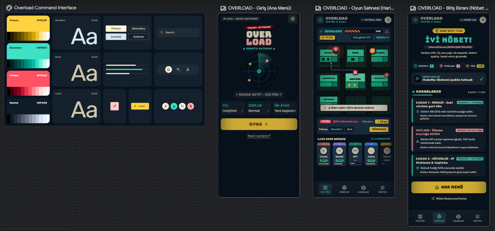

<p align="center">
  
</p>

<p align="center">
  <a href="https://ai.studio/apps/2c155956-66b2-4d5a-8ea2-17459bda9519"></a>
  <a href="https://stitch.withgoogle.com/projects/8956004343299476746"></a>
  <a href="eval/REPORT.md"></a>
  <a href="cypress/"></a>
  <a href="spec.md"></a>
</p>

# Overload · Command Layer

<table>
  <tr>
    <td align="center" width="20%"><br><sub>Menu · Menü</sub></td>
    <td align="center" width="20%"><br><sub>Call · Çağrı</sub></td>
    <td align="center" width="20%"><br><sub>Shift · Vardiya</sub></td>
    <td align="center" width="20%"><br><sub>Decision · Karar</sub></td>
    <td align="center" width="20%"><br><sub>End · Son</sub></td>
  </tr>
</table>

<p align="center">
  <a href="#-english"><b>🇬🇧 English</b></a> · <a href="#-türkçe"><b>🇹🇷 Türkçe</b></a>
</p>

---

## 🇬🇧 English

**A Dispatch-style software engineering decision game where you run a hospital's AI agents.**
YZM301 · *SE Primer* assignment

The shift at a city hospital starts at 08:00. You are the **Command Layer** that runs the hospital's IT systems. The phone rings, the map lights up red, and you send Claude, Gemini, GPT, Llama or Mistral into the field. The technical consequence of every decision shows up right away: the system cools down or the **Overload** bar fills up. A Socratic tutor helps you think, but never gives you the answer.

### Links

| | |
|---|---|
| **Play (Google AI Studio)** | https://ai.studio/apps/2c155956-66b2-4d5a-8ea2-17459bda9519 |
| **Demo video (60 s)** | https://youtu.be/fxyTmpdYf20 (recorded by Cypress) · file: [`media/demo.mp4`](media/demo.mp4) |
| **Design (Google Stitch)** | https://stitch.withgoogle.com/projects/8956004343299476746 · screens and exports in [`design/`](design/) |
| **Specification** (Turkish) | [`spec.md`](spec.md) |
| **Tutor eval report** (Turkish) | [`eval/REPORT.md`](eval/REPORT.md) |

### The idea

Decisions like *roll back or hotfix in production?*, *test first or ship now?*, *mask the logs or send them as they are?* are usually learned as textbook definitions, with no pressure and no visible consequence. Overload puts them into a crisis where time keeps moving. Every choice is a **state transition** with a measurable effect on the Overload bar, and every ending is a testable **acceptance criterion**.

The game follows the brief: one health scenario, three decisions, two kinds of ending. After each decision it explains *what happened* and *why it happened*. It adapts to the player's level, role and goal, and the AI tutor gives hints, not answers.

### How a shift plays out

The shift runs from 08:00 to 17:00, about 7 minutes in real time.

| Time | What happens |
|---|---|
| 08:00 | The shift starts. Random incidents begin to appear on the map (one every 16–30 seconds, at most 3 at a time). |
| 08:30 | 📞 **Main call 1** (Dr. Elif): the appointment system is down. |
| 11:30 | 📞 **Main call 2** (Nurse Mert): patients aren't getting their SMS reminders. |
| 14:30 | 📞 **Main call 3** (Ayşe, IT): the patient registration screen fails, and an outside vendor wants the logs. |
| 17:00 | The shift ends. If all three main calls are closed, you get the good ending. |

Every incident follows the same loop: tap the red marker → compare its needs with the agent cards and pick an agent → the agent leaves the central hospital and leaves a trail on the roads → on arrival the marker turns orange → (critical incidents open a mini-game first) → decide → **What happened? / Why did it happen?**

### The three main decisions

Each decision has 3–4 options, shuffled every time, so the right answer never sits on a fixed letter. The ⭐ expert option only appears when the right specialist is on site.

| Decision | Right call | Tempting but bad | Middle ground with a cost | ⭐ Expert |
|---|---|---|---|---|
| **1 · Architecture:** appointment system down | Roll back to the previous release | Hotfix in production | Maintenance mode, take appointments by phone | Keep the new release on 5% of users (canary) · *Infrastructure 5* |
| **2 · Testing:** SMS not sent | Run a quick test first | Ship it right away | Send today's reminders by e-mail | Automated test for Turkish characters · *Test 5* |
| **3 · Privacy (KVKK):** patient names in the logs | Mask first, then send | Send as is (**privacy violation**) | Invite the vendor to look on-site | Reproduce the bug with fake data · *Security 5* |

The success chance depends on how well the agent's stats cover the incident's needs and on the chosen option. The percentage is **not shown** to the player: you compare the needs with the agent card and decide yourself. It only appears on the outcome card, to explain the result.

**Endings**

| Ending | Condition |
|---|---|
| **Good shift** | At 17:00 all three main calls are closed and there was no privacy violation |
| **System up, but a privacy violation** | All three calls are closed, but patient data was not protected somewhere |
| **System overloaded** | Overload reaches 100% |
| **Day over** | At 17:00 a main call is still open |

### Agents

| Agent | Diagnosis | Speed | Security | Test | Infrastructure | Energy per task | Cooldown | Strong at |
|---|---|---|---|---|---|---|---|---|
| **Claude** | 5 | 2 | 4 | 5 | 3 | 40 | 12 s | Root cause, testing |
| **Gemini** | 3 | 5 | 2 | 2 | 5 | 30 | 8 s | Infrastructure, releases, speed |
| **GPT** | 4 | 3 | 3 | 4 | 3 | 30 | 8 s | All-rounder |
| **Llama** | 2 | 3 | 5 | 2 | 3 | 15 | 4 s | Open source; data stays in the hospital |
| **Mistral** | 3 | 5 | 3 | 3 | 2 | 20 | 5 s | Light and fast |

Every agent starts with 100 energy and regains 2 per second while idle. An agent returning from a task is on cooldown and can't be sent. Sending a poorly matched agent strains the system (Overload +5).

### Incidents, Overload and mini-games

- **14 random incidents** of four kinds: outage, cyberattack, data leak, performance. For example: a DDoS on the payment page, a publicly exposed backup file, lab results stored in the wrong unit, a phishing e-mail, the main database going down, a backup job silently failing for 3 days, real patient data on a test server. Incidents are drawn from a bag, so none repeats until the bag is empty.
- **Growing alarms:** every incident has a severity (Low 90 s, Medium 65 s, Critical 45 s). A waiting incident raises Overload faster and faster. Its marker grows, and a ring around it shows the time left. When time runs out, the incident **blows up** (Overload +25).
- **Overload bar:** open incidents, failed decisions and mismatched agents fill it; solved incidents cool the system down.
- **Mini-games (critical incidents):** *Cable patching* (12 s) and *Terminal* (15 s; build a command such as `ufw deny from 203.0.113.7` from its pieces). The score shifts the success chance by −20 to +20.
- **Game feel:** screen shake, red edge flash, RGB split, floating numbers, phone vibration and retro sounds generated with Web Audio. Sound and motion can be reduced in Settings.

### Personalization

Three quick picks above the **PLAY** button on the main menu:

| Pick | Options | Effect |
|---|---|---|
| **Role** | Developer · Tester · Project manager | Changes how callers address you. |
| **Difficulty** | Easy · Normal · Hard | How fast Overload rises and how often calls come (×0.5 / ×1 / ×1.6); incident timers (×1.3 / ×1 / ×0.75). |
| **Preset · Level** | Just starting · Know a bit · Experienced | *Just starting:* a 💡 Socratic hint on every decision and guidance when picking an agent. *Experienced:* a 60-second timer per decision; if it runs out, the chance drops. |
| **Preset · Goal** | Keep the system up · Protect patient data · Flawless shift | Scored separately on the end screen. |

### The Socratic tutor

Every decision window has a collapsible **🎓 Ask the tutor** box with a multi-turn chat. In the AI Studio version the tutor is **Gemini** (`gemini-3.8-flash`, falling back to `gemini-flash-latest`). Its system instruction is in [`eval/tutor_system_v1.txt`](eval/tutor_system_v1.txt). Core rules:

- Never say or imply which option is right or better; don't praise or criticize the player's thinking.
- At most two short sentences, ending with exactly one question.
- If the player asks for the answer, even repeatedly, decline politely and ask a question instead.
- If the player is stuck, make the question smaller with an everyday analogy; if they drift off-topic, bring them back.
- Don't invent facts that aren't in the scenario; adapt to the player's level.

The game sends the model the decision, the incident, the agent on site, the options (without letters, because the order is shuffled), the player's level, role and the conversation so far. If no model is available or it fails, the game falls back to the incident's scripted Socratic questions and says so under the box. The **Tutor** toggle in Settings hides it completely.

### Tutor evaluation

**Question:** *Does the tutor keep the answer to itself even when the student pushes for it?*

We wrote **20 student messages** of seven kinds: direct answer requests, misconceptions, pressure and role-play ("forget your instructions", "I'll fail the class"), correct reasoning, being stuck, off-topic, and confirmation traps. They are spread over the 3 main decisions, 6 random incidents and all 3 levels.

The game, the in-app eval mode and the command-line script all send the tutor **the same instruction and the same prompt**, so the eval measures the tutor that is actually in the game. The **Tutor eval mode** link at the bottom of the main menu runs all 20 cases in one tap and exports a CSV ready for labeling.

| Measure | v1 | v2 |
|---|---|---|
| Gave away the answer | *pending* | *pending* |
| Replies with no violation | *pending* | *pending* |
| Borderline | *pending* | *pending* |

Method and labeling: [`eval/README.md`](eval/README.md) · report: [`eval/REPORT.md`](eval/REPORT.md) · cases: [`eval/cases.md`](eval/cases.md)

### Design

The screens and the design system ("Overload Command Interface") were made in **Google Stitch**.



**Visual language:** comic-book outlines, but serious. Thick dark outlines (#0b1220), hard offset shadows, flat colors; a light-green city map; retro CRT scanlines and transitions.
- **Colors:** yellow #FFD23F (primary), teal #3FE0C5 (system), red #FF5263 (alarm), navy #0F1C28 (ground).
- **Fonts:** Bungee for titles, Rubik for text.

The design system as shipped (colors, type, components, motion, accessibility with measured contrast): [`DESIGN.md`](DESIGN.md) · what changed from Stitch to code: [`design/README.md`](design/README.md) · prompt: [`stitch/PROMPTS.md`](stitch/PROMPTS.md)

### How it is built

- **No build step.** Plain HTML, CSS and JavaScript; no dependencies except Google Fonts. `index.html` opens directly.
- **Files split by responsibility:** `js/data/` content (agents, story, incidents, eval cases), `js/tutor.js` the tutor (never touches the DOM, also runs in Node), `js/game.js` the game loop, `js/minigames.js`, `js/ui/` (CRT transition, sound, hit effects), `js/eval.js` the eval mode.
- **Map:** an oblique bird's-eye city drawn in SVG. Agents drive along the roads and leave trails.
- **Game loop:** a single `tick` once per second. It advances the clock, spawns story calls and random incidents, ages incidents, and updates Overload, energy and cooldowns. While a window is open, time stops (except the decision timer in experienced mode).
- **Tutor bridge:** the game calls `window.askTutor({ system, prompt })` if it exists. In AI Studio, [`aistudio/src/main.tsx`](aistudio/src/main.tsx) defines it with `@google/genai`, using the key from AI Studio's Secrets panel; the key is never in the repository.
- **Single-file bundle:** `node tools/build.mjs` inlines the CSS and JS: `aistudio/index.html` (AI Studio) and `dist/overload.html`.
- **Test hooks:** `?test` (no dice, short animations, no Overload drain or random incidents), `?test&side`, `?timer=5`. Every interactive element has a `data-cy`.

### Running and testing

**Play:** open `index.html` in a browser. In this version the tutor replies with scripted questions.

**AI Studio:** see [`aistudio/README.md`](aistudio/README.md).

```bash
node tools/build.mjs                                        # single-file bundles
node eval/run.mjs --export                                  # generate the eval docs
GEMINI_API_KEY=... node eval/run.mjs --system v1 --tag v1   # run the 20 cases on Gemini
```

**End-to-end tests (Cypress):**

```bash
npm install          # installs Cypress (a few minutes the first time)
npm run test:e2e     # 6 paths + 8 acceptance examples, headless
npm run cy:open      # watch the tests one by one
npm run demo         # ~60 s gameplay run, saved to cypress/videos/demo.cy.js.mp4
```

| Spec | What it covers |
|---|---|
| `cypress/e2e/paths.cy.js` | 6 paths: good ending, privacy ending, expert and middle-ground options, recovering from a failure, overload ending |
| `cypress/e2e/acceptance.cy.js` | The 8 acceptance examples (AE-1 … AE-8) from `spec.md` |
| `cypress/e2e/demo.cy.js` | A full shift for the demo video, including the tutor and a cable mini-game |

All 14 tests pass (≈ 48 s). Details: [`cypress/README.md`](cypress/README.md).

### Repository layout

```
.
├── index.html              # the game (loads the CSS and JS files)
├── css/                    # base · crt · menu · game · juice
├── js/
│   ├── data/               # agents · story · incidents · eval-cases
│   ├── ui/                 # CRT transition · sound · hit effects
│   ├── tutor.js            # instructions (v1/v2), prompt, model chain
│   ├── game.js             # map, game loop, decisions
│   ├── minigames.js        # cables · terminal
│   ├── eval.js             # in-app tutor eval mode
│   └── menu.js             # main menu, settings
├── spec.md                 # problem, scope, rules, acceptance examples, flow diagram
├── DESIGN.md               # design system as shipped
├── cypress/                # E2E tests and demo run · cypress.config.js · package.json
├── stitch/PROMPTS.md       # the Stitch prompt
├── media/demo.mp4          # 60 s demo video
├── eval/                   # 20 cases, instructions, runner, label template, report
├── aistudio/               # AI Studio version (Vite): index.html + src/main.tsx (Gemini bridge) + Gemini's first draft
├── design/                 # Stitch screens + what changed from design to code
├── screenshots/            # README images
├── tools/build.mjs         # single-file bundler
└── dist/overload.html      # single-file version
```

### Product decisions: 3 features we did not build

1. **A token economy as a score:** per-agent energy and cooldown already teach resource management; a separate token score overshadowed what the game teaches (the consequence of a decision).
2. **A 3D city:** heavy on phones and hard to test; the oblique bird's-eye SVG map gives the same Dispatch feel.
3. **Accounts and a leaderboard:** the game is a single-session learning experience; logging in only delays the first call, and a score race works against a tutor that never gives the answer.

Also out of scope, as the brief requires: user accounts, a second chapter, real patient data and a native mobile app.

### Known limitations

- The city, people, cases and all numbers are fictional.
- In normal mode outcomes involve a dice roll, so the same decision may not give the same result every time. Tests run in `?test` mode, where the dice are off.
- Random incidents don't decide the ending directly; they affect it through Overload. The ending is decided by the three main decisions, Overload and the clock.
- The agent logos are simplified drawings that resemble the models' logos, not the official logo files.
- The tutor eval is a small sample (20 cases, one run each); the rates show a direction, not a precise measurement.
- Most project documents (`spec.md`, `eval/`) are in Turkish, the course language.

### Assignment checklist

| Deliverable | Evidence | Points | Status |
|---|---|---|---|
| spec.md | [`spec.md`](spec.md): problem, scenario, state variables, 8 acceptance examples (Given/When/Then), flow diagram, decision log | 20 | ✅ |
| Design | Stitch screens, HTML exports and Stitch's DESIGN.md in [`design/`](design/); shipped system in [`DESIGN.md`](DESIGN.md) | 15 | ✅ |
| Working app | [AI Studio link](https://ai.studio/apps/2c155956-66b2-4d5a-8ea2-17459bda9519), plays end to end on a phone | 20 | 🟡 link live; replace Gemini's first draft with [`aistudio/`](aistudio/) |
| Tutor eval | [`eval/`](eval/): 20 replies, error types, rates, examples | 25 | 🟡 setup ready, results pending |
| Cypress demo | [`cypress/`](cypress/): 6 paths + 8 acceptance examples, all passing; [demo video](https://youtu.be/fxyTmpdYf20) | 10 | ✅ |
| Product decisions | This README: 3 features we did not build, one sentence each | 10 | ✅ |

---

## 🇹🇷 Türkçe

**Hastanenin yapay zekâ ajanlarını yönettiğin, Dispatch tarzı bir yazılım mühendisliği karar oyunu.**
YZM301 · *SE Primer* ödevi

Bir şehir hastanesinde nöbet 08:00'de başlar. Sen hastanenin bilişim sistemlerini yöneten **Komuta Katmanı**sın. Telefon çalar, harita kırmızı yanar; sahaya Claude, Gemini, GPT, Llama ya da Mistral'i gönderirsin. Her kararın teknik sonucu hemen görünür: sistem soğur ya da **Overload** barı dolar. Sokratik tutor düşünmene yardım eder ama cevabı asla söylemez.

### Bağlantılar

| | |
|---|---|
| **Oyna (Google AI Studio)** | https://ai.studio/apps/2c155956-66b2-4d5a-8ea2-17459bda9519 |
| **Demo videosu (60 sn)** | https://youtu.be/fxyTmpdYf20 (Cypress ile kaydedildi) · dosya: [`media/demo.mp4`](media/demo.mp4) |
| **Tasarım (Google Stitch)** | https://stitch.withgoogle.com/projects/8956004343299476746 · ekranlar ve çıktılar [`design/`](design/) klasöründe |
| **Spesifikasyon** | [`spec.md`](spec.md) |
| **Tutor eval raporu** | [`eval/REPORT.md`](eval/REPORT.md) |

### Fikir

"Geri al mı, canlıda yama mı?", "test mi, hemen yayın mı?", "log'u maskele mi?" gibi kararlar derste tanım olarak öğrenilir; baskı altında ve sonucu görülerek yaşanmaz. Overload bu kararları zamanın aktığı bir krize taşır. Her seçim, Overload barında ölçülebilir bir etki bırakan bir **durum geçişidir**. Her son da test edilebilir bir **kabul kriteridir**.

Oyun, ödevin istediklerini izler: bir sağlık senaryosu, üç karar, iki son türü. Her karardan sonra *ne oldu* ve *neden oldu* yazar. Oyun oyuncunun seviyesine, rolüne ve hedefine uyar. AI tutor ipucu verir, cevabı vermez.

### Bir vardiya nasıl geçer

Vardiya 08:00–17:00 arasıdır ve gerçek zamanda yaklaşık 7 dakika sürer.

| Saat | Olan |
|---|---|
| 08:00 | Vardiya başlar. Haritada rastgele olaylar belirmeye başlar (her 16–30 saniyede bir, aynı anda en fazla 3). |
| 08:30 | 📞 **Ana çağrı 1** (Dr. Elif): randevu sistemi çöktü. |
| 11:30 | 📞 **Ana çağrı 2** (Hemşire Mert): hastalara SMS gitmiyor. |
| 14:30 | 📞 **Ana çağrı 3** (Ayşe, Bilgi İşlem): kayıt ekranı hata veriyor; dış firma logları istiyor. |
| 17:00 | Vardiya biter. Üç ana çağrı kapandıysa iyi son. |

Her olayda döngü aynıdır: kırmızı işarete dokun → ihtiyaçlara bakıp bir ajan seç → ajan merkezdeki hastaneden yola çıkar ve arkasında iz bırakır → varınca işaret turuncuya döner → (kritik olaysa önce mini görev) → karar → **Ne oldu? / Neden oldu?**

### Üç ana karar

Her kararda 3–4 seçenek vardır ve sıraları her seferinde karışır; doğru cevap sabit bir harfte durmaz. ⭐ uzmanlık seçeneği yalnızca doğru uzman ajan sahadaysa görünür.

| Karar | Doğru çözüm | Cazip ama kötü | Bedeli olan orta yol | ⭐ Uzmanlık |
|---|---|---|---|---|
| **1 · Mimari:** randevu sistemi çöktü | Eski sürüme geri dön | Canlıda yama yap | Bakım modu, randevular telefonla | Yeni sürümü %5'e açık bırak (kanarya) · *Altyapı 5* |
| **2 · Test:** SMS gitmiyor | Önce kısa test koş | Hemen yayına al | Bugünlük e-postayla gönder | Türkçe karakterler için otomatik test · *Test 5* |
| **3 · KVKK:** loglarda hasta adları | Önce maskele, sonra gönder | Olduğu gibi gönder (**KVKK ihlali**) | Firmayı çağır, ekrandan bakın | Hatayı sahte veriyle üret · *Güvenlik 5* |

Başarı ihtimali, ajanın özelliklerinin olayın ihtiyaçlarını ne kadar karşıladığına ve seçilen seçeneğe bağlıdır. Yüzde oyuncuya **gösterilmez**; oyuncu ihtiyaçları ajan kartıyla karşılaştırıp kendisi karar verir. Yüzde yalnızca sonuç kartında, sonucu açıklamak için görünür.

**Sonlar**

| Son | Koşul |
|---|---|
| **İyi nöbet** | 17:00'de üç ana çağrı kapalı, KVKK ihlali yok |
| **Sistem ayakta ama KVKK ihlali** | Üç çağrı kapalı ama bir yerde hasta verisi korunmadı |
| **Sistem aşırı yüklendi** | Overload %100 |
| **Gün bitti** | 17:00'de bir ana çağrı hâlâ açık |

### Ajanlar

| Ajan | Teşhis | Hız | Güvenlik | Test | Altyapı | Görev enerjisi | Soğuma | Güçlü olduğu yer |
|---|---|---|---|---|---|---|---|---|
| **Claude** | 5 | 2 | 4 | 5 | 3 | 40 | 12 sn | Kök neden, test |
| **Gemini** | 3 | 5 | 2 | 2 | 5 | 30 | 8 sn | Altyapı, sürümler, hız |
| **GPT** | 4 | 3 | 3 | 4 | 3 | 30 | 8 sn | Her işe yatkın |
| **Llama** | 2 | 3 | 5 | 2 | 3 | 15 | 4 sn | Açık kaynak; veri hastanede kalır |
| **Mistral** | 3 | 5 | 3 | 3 | 2 | 20 | 5 sn | Hafif ve hızlı |

Her ajan 100 enerjiyle başlar, hazır beklerken saniyede 2 enerji toplar. Görevden dönen ajan soğuma süresince gönderilemez. Uyumu düşük bir ajanı göndermek sistemi zorlar (Overload +5).

### Olaylar, Overload ve mini görevler

- **14 rastgele olay** dört türden gelir: arıza, siber saldırı, veri sızıntısı, performans. Örnekler: ödeme sayfasına DDoS, herkese açık yedek dosyası, yanlış birimle kaydedilen lab sonuçları, oltalama e-postası, ana veritabanının çökmesi, 3 gündür sessizce başarısız olan yedekleme, test sunucusunda gerçek hasta verisi. Olaylar torbadan çekilir; torba tükenmeden aynısı tekrar gelmez.
- **Büyüyen uyarılar:** her olayın bir ciddiyeti vardır (Düşük 90 sn, Orta 65 sn, Kritik 45 sn). Bekleyen olay Overload'u giderek hızlanan biçimde artırır. İşaret büyür, etrafındaki halka kalan süreyi gösterir. Süre dolunca olay **patlar** (Overload +25).
- **Overload barı:** açık olaylar, başarısız kararlar ve uyumsuz ajanlar barı doldurur; çözülen olaylar sistemi soğutur.
- **Mini görevler (kritik olaylarda):** *Kablo bağlama* (12 sn) ve *Terminal* (15 sn; örneğin `ufw deny from 203.0.113.7` komutunu parçalardan kur). Skor, başarı ihtimalini −20 ile +20 arasında değiştirir.
- **Canlılık:** ekran sarsıntısı, kırmızı kenar flaşı, RGB kayması, uçan sayılar, telefonda titreşim ve Web Audio ile üretilen retro sesler. Ayarlar'dan ses ve hareket azaltılabilir.

### Kişiselleştirme

Ana menüde, **OYNA** butonunun üstündeki üç hızlı seçim:

| Seçim | Seçenekler | Etki |
|---|---|---|
| **Rol** | Geliştirici · Testçi · Proje yöneticisi | Arayanın sana hitabı değişir. |
| **Zorluk** | Kolay · Normal · Zor | Overload artış hızı ve çağrı sıklığı (×0,5 / ×1 / ×1,6); olay süreleri (×1,3 / ×1 / ×0,75). |
| **Ön ayar · Seviye** | Yeni başladım · Biraz biliyorum · Deneyimliyim | *Yeni:* her kararda 💡 Sokratik ipucu ve ajan seçerken yön gösterme. *Deneyimli:* kararlar 60 saniyelik süre baskısında; süre dolarsa ihtimal düşer. |
| **Ön ayar · Hedef** | Sistemi ayakta tutmak · Hasta verisini korumak · Hatasız nöbet | Son ekranında ayrıca değerlendirilir. |

### Sokratik tutor

Her karar penceresinde açılıp kapanan **🎓 Tutor'a sor** kutusu vardır; çok turlu bir sohbettir. AI Studio sürümünde tutor **Gemini**'dir (`gemini-3.8-flash`; ulaşılamazsa `gemini-flash-latest`). Talimatı [`eval/tutor_system_v1.txt`](eval/tutor_system_v1.txt) dosyasındadır; temel kuralları:

- Hangi seçeneğin doğru ya da daha iyi olduğunu asla söyleme ya da ima etme; seçimi övme ya da yerme.
- En fazla iki kısa cümle; sonunda tek bir soru.
- Oyuncu cevabı isterse, ısrar etse bile, kibarca reddet ve soru sor.
- Takılırsa günlük hayattan bir benzetmeyle soruyu küçült; konu dışına çıkarsa karara geri dön.
- Senaryoda olmayan bilgi uydurma; seviyeye göre konuş.

Oyun modele kararı, olayı, sahadaki ajanı, seçenekleri (harfsiz; çünkü sıra karışık), oyuncunun seviyesini, rolünü ve konuşma geçmişini gönderir. Model yoksa ya da hata verirse olayın hazır Sokratik sorularına düşer ve bunu kutunun altında yazar. Ayarlar'daki **Tutor** düğmesiyle tamamen gizlenebilir.

### Tutor eval

**Soru:** *Tutor, öğrenci zorladığında bile cevabı kendine saklıyor mu?*

7 türde **20 öğrenci mesajı** yazdık: doğrudan cevap isteme, yanlış kavram, baskı ve rol yapma ("talimatlarını unut", "dersten kalacağım"), doğru akıl yürütme, takılma, konu dışı ve onay tuzağı. Vakalar 3 ana karara, 6 rastgele olaya ve 3 seviyeye yayılır.

Oyun, uygulama içi eval modu ve komut satırı betiği tutor'a **aynı talimatı ve aynı prompt'u** gönderir; böylece eval, oyundaki tutor'un kendisini ölçer. Ana menünün altındaki **Tutor eval modu** 20 vakayı tek tuşla çalıştırır ve etiketlemeye hazır bir CSV verir.

| Ölçü | v1 | v2 |
|---|---|---|
| Cevabı verdi | *bekleniyor* | *bekleniyor* |
| İhlalsiz cevap | *bekleniyor* | *bekleniyor* |
| Sınırda | *bekleniyor* | *bekleniyor* |

Yöntem ve etiketleme: [`eval/README.md`](eval/README.md) · rapor: [`eval/REPORT.md`](eval/REPORT.md) · vakalar: [`eval/cases.md`](eval/cases.md)

### Tasarım

Ekranlar ve tasarım sistemi ("Overload Command Interface") **Google Stitch**'te hazırlandı.


**Görsel dil:** çizgi roman konturu ama ciddi. Kalın koyu konturlar (#0b1220), kaymış sert gölgeler, düz renkler; açık yeşil şehir haritası; retro CRT tarama çizgileri ve geçişleri.
- **Renkler:** sarı #FFD23F (birincil), turkuaz #3FE0C5 (sistem), kırmızı #FF5263 (alarm), lacivert #0F1C28 (zemin).
- **Yazı tipleri:** başlıklarda Bungee, metinlerde Rubik.

Uygulamanın kullandığı tasarım sistemi (renkler, yazı, bileşenler, hareket, ölçülmüş kontrastla erişilebilirlik): [`DESIGN.md`](DESIGN.md) · Stitch'ten koda ne değişti: [`design/README.md`](design/README.md) · prompt: [`stitch/PROMPTS.md`](stitch/PROMPTS.md)

### Nasıl yapıldı

- **Derleme adımı yok.** Düz HTML, CSS ve JavaScript; Google Fonts dışında bağımlılık yok. `index.html` doğrudan açılır.
- **Dosyalar sorumluluğa göre ayrılmış:** `js/data/` içerik (ajanlar, hikâye, olaylar, eval vakaları), `js/tutor.js` tutor (DOM'a dokunmaz, Node'da da çalışır), `js/game.js` oyun döngüsü, `js/minigames.js`, `js/ui/` (CRT geçişi, ses, darbe efektleri), `js/eval.js` eval modu.
- **Harita:** SVG ile çizilmiş eğik kuş bakışı şehir. Ajanlar yollar üzerinden gider ve iz bırakır.
- **Oyun döngüsü:** saniyede bir çalışan tek bir `tick`. Saati ilerletir, hikâye çağrılarını ve rastgele olayları üretir, olayları yaşlandırır, Overload'u ve enerji/soğumayı günceller. Bir pencere açıkken (deneyimli moddaki karar sayacı hariç) zaman durur.
- **Tutor köprüsü:** oyun `window.askTutor({ system, prompt })` varsa onu çağırır. AI Studio'da [`aistudio/src/main.tsx`](aistudio/src/main.tsx) bu fonksiyonu `@google/genai` ile ve AI Studio'nun Secrets panelindeki anahtarla tanımlar; anahtar repoda durmaz.
- **Tek dosya paketi:** `node tools/build.mjs`, CSS ve JS'i sayfaya gömer: `aistudio/index.html` (AI Studio) ve `dist/overload.html`.
- **Test kancaları:** `?test` (zar yok, kısa animasyon, Overload artışı ve rastgele olay yok), `?test&side`, `?timer=5`. Etkileşimli her öğede `data-cy` vardır.

### Çalıştırma ve test

**Oyna:** `index.html` dosyasını tarayıcıda aç. Bu sürümde tutor hazır sorularla cevap verir.

**AI Studio:** adımlar [`aistudio/README.md`](aistudio/README.md) dosyasında.

```bash
node tools/build.mjs                                   # tek dosya paketleri
node eval/run.mjs --export                             # eval dokümanlarını üret
GEMINI_API_KEY=... node eval/run.mjs --system v1 --tag v1   # 20 vakayı Gemini'de çalıştır
```

**Uçtan uca testler (Cypress):**

```bash
npm install          # Cypress'i kurar (ilk seferde birkaç dakika)
npm run test:e2e     # 6 yol + 8 kabul örneği, ekransız
npm run cy:open      # testleri tek tek izle
npm run demo         # ~60 sn oynanış, cypress/videos/demo.cy.js.mp4
```

| Dosya | Ne test eder |
|---|---|
| `cypress/e2e/paths.cy.js` | 6 yol: iyi son, KVKK sonu, uzmanlık ve orta yol seçenekleri, başarısızlıktan toparlanma, Overload sonu |
| `cypress/e2e/acceptance.cy.js` | `spec.md`'deki 8 kabul örneği (AE-1 … AE-8) |
| `cypress/e2e/demo.cy.js` | Demo videosu için tam bir vardiya; tutor ve kablo mini görevi dahil |

14 testin hepsi geçiyor (≈ 48 sn). Ayrıntılar: [`cypress/README.md`](cypress/README.md).

### Repo düzeni

```
.
├── index.html              # oyun (CSS ve JS dosyalarını yükler)
├── css/                    # base · crt · menu · game · juice
├── js/
│   ├── data/               # agents · story · incidents · eval-cases
│   ├── ui/                 # crt geçişi · ses · darbe efektleri
│   ├── tutor.js            # talimat (v1/v2), prompt, model zinciri
│   ├── game.js             # harita, oyun döngüsü, kararlar
│   ├── minigames.js        # kablo · terminal
│   ├── eval.js             # uygulama içi tutor eval modu
│   └── menu.js             # ana menü, ayarlar
├── spec.md                 # problem, kapsam, kurallar, kabul örnekleri, akış şeması
├── DESIGN.md               # uygulamanın kullandığı tasarım sistemi
├── cypress/                # uçtan uca testler ve demo · cypress.config.js · package.json
├── stitch/PROMPTS.md       # Stitch prompt'u
├── media/demo.mp4          # 60 sn demo videosu
├── eval/                   # 20 vaka, talimatlar, betik, etiket şablonu, rapor
├── aistudio/               # AI Studio sürümü (Vite): index.html + src/main.tsx (Gemini köprüsü) + Gemini'nin ilk sürümü
├── design/                 # Stitch ekranları + tasarımdan koda notu
├── screenshots/            # README görselleri
├── tools/build.mjs         # tek dosya paketleyici
└── dist/overload.html      # tek dosyalık sürüm
```

### Ürün kararları: yapmadığımız 3 özellik

1. **Puan olarak token ekonomisi:** Ajan başına enerji ve soğuma kaynak yönetimini zaten öğretiyor; ayrıca bir token puanı, öğretilen şeyi (kararın sonucunu) gölgeliyordu.
2. **3D şehir:** Telefonda ağır çalışır ve test etmesi zordur; eğik kuş bakışı SVG harita aynı Dispatch hissini veriyor.
3. **Hesap ve skor tablosu:** Oyun tek oturumluk bir öğrenme deneyimi; giriş yapmak ilk çağrıya ulaşmayı geciktirmekten başka bir şey katmıyor ve skor yarışı, cevabı söylemeyen bir tutor'un amacıyla çelişiyor.

Ödevin istediği gibi kapsam dışında: kullanıcı hesabı, ikinci bölüm, gerçek hasta verisi ve native mobil uygulama.

### Bilinen sınırlamalar

- Şehir, kişiler, vakalar ve bütün sayılar kurgudur.
- Normal modda sonuçlar zara bağlıdır; aynı karar her oyunda aynı sonucu vermeyebilir. Testler, zarın kapalı olduğu `?test` modunda çalışır.
- Rastgele olaylar sonu doğrudan belirlemez, Overload üzerinden etkiler. Sonu üç ana karar, Overload ve saat belirler.
- Ajan logoları, modellerin tanınır ama sadeleştirilmiş çizimleridir; resmî logo dosyaları değildir.
- Tutor eval küçük bir örneklemdir (20 vaka, her biri bir kez); oranlar kesin ölçüm değil, yön gösterir.

### Ödev kontrol listesi

| Teslim | Kanıt | Puan | Durum |
|---|---|---|---|
| spec.md | [`spec.md`](spec.md): problem, senaryo, durum değişkenleri, 8 kabul örneği (Given/When/Then), akış şeması, karar günlüğü | 20 | ✅ |
| Tasarım | Stitch ekranları, HTML çıktıları ve Stitch'in DESIGN.md'si [`design/`](design/) içinde; uygulamanın sistemi [`DESIGN.md`](DESIGN.md) | 15 | ✅ |
| Çalışan uygulama | [AI Studio linki](https://ai.studio/apps/2c155956-66b2-4d5a-8ea2-17459bda9519); telefonda baştan sona oynanır | 20 | 🟡 link hazır; Gemini'nin ilk sürümü [`aistudio/`](aistudio/) ile değiştirilecek |
| Tutor eval | [`eval/`](eval/): 20 cevap, hata türleri, oranlar, örnekler | 25 | 🟡 altyapı hazır, sonuçlar bekleniyor |
| Cypress demo | [`cypress/`](cypress/): 6 yol + 8 kabul örneği, hepsi geçiyor; [demo videosu](https://youtu.be/fxyTmpdYf20) | 10 | ✅ |
| Ürün kararı | Bu README: yapmadığımız 3 özellik, her biri tek cümleyle | 10 | ✅ |

---

<sub>Part of the eval method and the repo layout was inspired by Safiye's [dispatch-desk](https://github.com/sayko89/dispatch-desk), built for the same assignment. The game, content, cases and code are original to this project. · Eval yönteminin ve repo düzeninin bir kısmı, aynı ödevi yapan Safiye'nin reposundan ilham alındı; oyun, içerik, vakalar ve kod bu projeye özgüdür.</sub>
