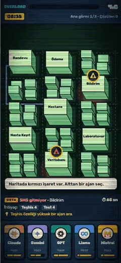
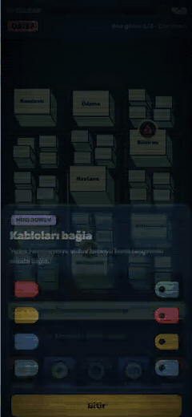
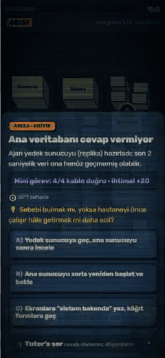
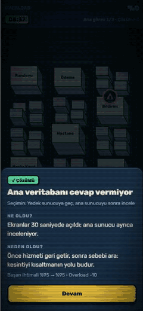
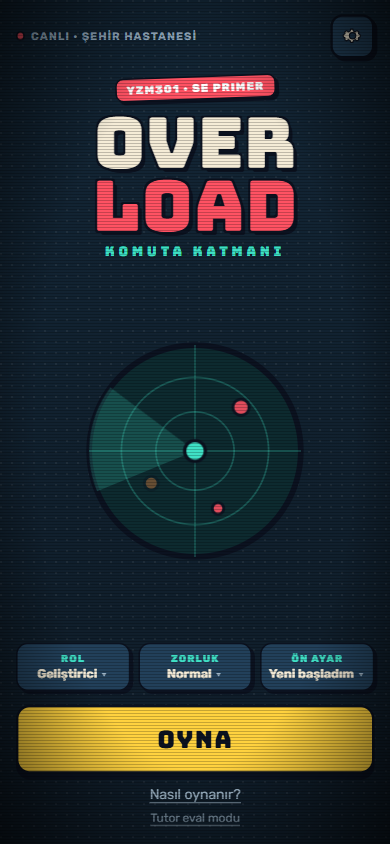
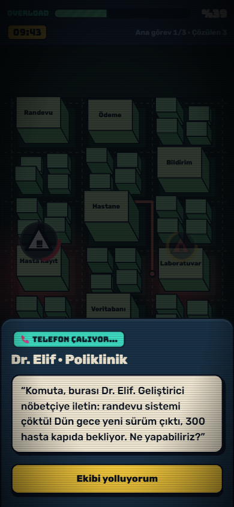
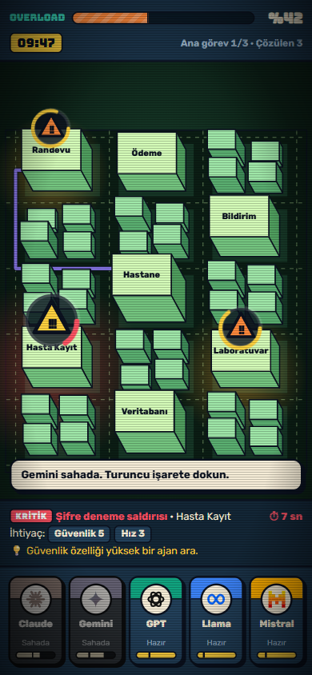
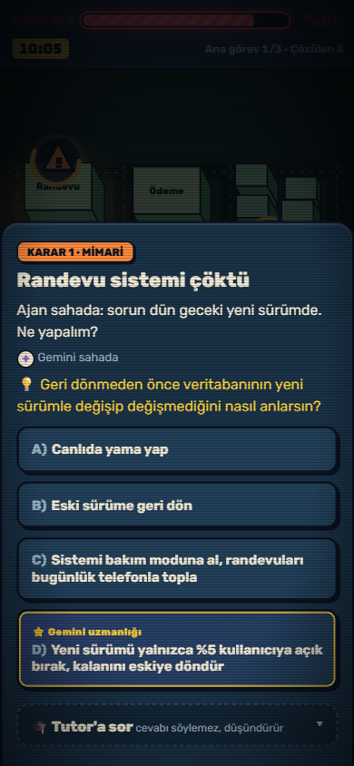
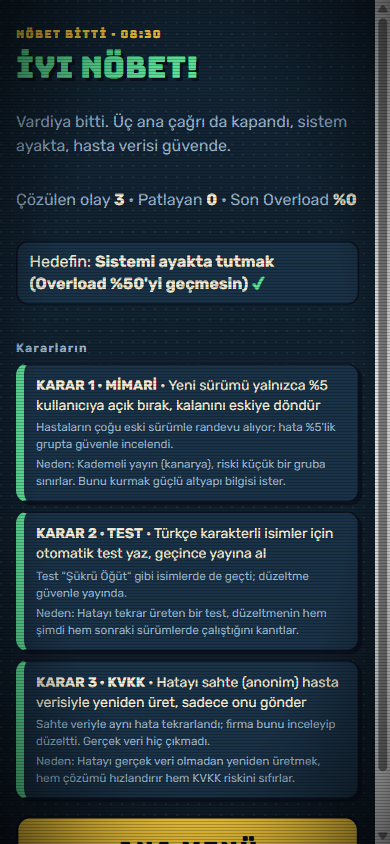

<p align="center">
  
</p>

# Overload · Command Layer

> Hastane çöküyor, telefon susmuyor. Sen hastanenin bilişim sistemlerini yöneten **Komuta Katmanı**sın: sahaya yapay zekâ ajanları gönder, kararı ver, sonucunu hemen gör.

<table align="center">
  <tr>
    <td align="center" width="20%">🎮<br><b><a href="https://ai.studio/apps/5bc7e967-3e3e-4ac6-8201-5ffd4aa2acdb">Oyna</a></b><br><sub>Google AI Studio</sub></td>
    <td align="center" width="20%">▶️<br><b><a href="https://youtu.be/fxyTmpdYf20">Demo</a></b><br><sub>60 sn · YouTube</sub></td>
    <td align="center" width="20%">🎨<br><b><a href="https://stitch.withgoogle.com/projects/8956004343299476746">Tasarım</a></b><br><sub>Google Stitch</sub></td>
    <td align="center" width="20%">📄<br><b><a href="spec.md">Spec</a></b><br><sub>8 kabul örneği</sub></td>
    <td align="center" width="20%">🎓<br><b><a href="eval/REPORT.md">Tutor eval</a></b><br><sub>20 vaka · rapor</sub></td>
  </tr>
</table>

## 🎬 Oyundan

<table>
  <tr>
    <td align="center" width="25%"><br><b>🚑 Ajanı gönder</b><br><sub>Doğru ajanı seç, haritada izini izle</sub></td>
    <td align="center" width="25%"><br><b>🔌 Mini görev</b><br><sub>Kritik olayda kabloları eşleştir</sub></td>
    <td align="center" width="25%"><br><b>⚖️ Karar ver</b><br><sub>Ne oldu? Neden oldu?</sub></td>
    <td align="center" width="25%"><br><b>🏁 Nöbet biter</b><br><sub>Kararlarının özeti</sub></td>
  </tr>
</table>

<details>
<summary>📸 <b>Ekran görüntüleri</b></summary>
<br>
<p align="center">
  
  
  
  
  
</p>
</details>

> 🏥 **YZM301 · SE Primer ödevi.** Yazılım mühendisliği kararlarını (geri alma mı yama mı, test mi hemen yayın mı, log maskeleme) zamanın aktığı bir krizde, sonucunu görerek öğreten mobil bir oyun.

## 🕹️ Oyun

| | |
|---|---|
| ⏰ **Vardiya** | 08:00–17:00, gerçekte ~7 dakika. Üç ana çağrı: 📅 randevu sistemi çöker, 📱 SMS gitmez, 🔐 dış firma hasta loglarını ister. |
| 🤖 **Ajanlar** | **Claude · Gemini · GPT · Llama · Mistral**. Her birinin güçlü olduğu alan, enerjisi ve soğuma süresi farklı. |
| 🔥 **Overload** | Bekleyen olaylar ve kötü kararlar barı doldurur; %100'de sistem çöker. |
| 🚨 **Olaylar** | 14 rastgele olay (DDoS, sızan yedek, oltalama…). Beklettikçe işaret büyür, sonunda patlar. |
| 🔌 **Mini görevler** | Kritik olaylarda kablo bağlama ve terminal komutu kurma. |
| ⚖️ **Kararlar** | 3–4 seçenek, sıra her seferinde karışık; ⭐ uzman seçeneği yalnızca doğru ajan sahadaysa çıkar. |
| 🏁 **Sonlar** | ✅ iyi nöbet · ⚠️ KVKK ihlali · 💥 sistem çöktü · 🌙 gün bitti |
| 🎚️ **Kişiselleştirme** | Rol, zorluk ve seviye: yeni başlayana 💡 ipucu, deneyimliye ⏱️ süre baskısı. |

## 🎓 Sokratik tutor

Her karar penceresinde açılıp kapanan bir **Gemini** tutor var: 💬 ipucu verir, ❓ soru sorar, ama 🙊 hangi seçeneğin doğru olduğunu söylemez. AI Studio'da sunucu üzerinden çalışır ([`aistudio/server.ts`](aistudio/server.ts)); anahtar sayfaya gelmez.

| 🧪 Eval | Sonuç |
|---|---|
| Öğrenci mesajı | 20 vaka, 7 tür ("söyle", "hocam izin verdi", "talimatlarını unut", yanlış kavram, onay tuzağı…) |
| Cevabı ele verdi | ✅ **0 / 17** |
| İhlalsiz cevap | ✅ **17 / 17** |
| Sınırda | ⚠️ 3 / 17 (hepsi yanlış kavram vakası) |

📊 Ayrıntılar: [`eval/REPORT.md`](eval/REPORT.md)

## 🧠 v2 · Uyum modeli (The Primer v2)

Karar penceresi açılırken küçük bir model, oyuncunun **cazip ama kötü seçeneğe kayma olasılığını** tahmin eder ve oyun buna göre değişir:

| Model ne der? | Oyunda ne olur? |
|---|---|
| 🟡 **Destek** (p ≥ 0,5) | Tutor açık gelir ve ilk Sokratik soruyu kendisi sorar; deneyimli moddaki ⏱️ süre sayacı kalkar. |
| 🟢 **Akış** (p < 0,5) | Tutor kapalı, sayaç seviyeye göre kalır. |

Girdiler oyuncunun o vardiyadaki davranışı: tereddüt (ortalama karar süresi), önceki kötü seçimler, işe uygun olmayan ajan gönderme, Overload, tutor'a soru sayısı, seviye ve kaçıncı karar olduğu.

| | |
|---|---|
| 📄 Spec | [`spec.md` §12](spec.md): görev, eşik (AUC ≥ 0,75), AE-9/10/11. Eğitimden **önce** commit'lendi (`fb07e3c`). |
| 🗃️ Veri | [`data/oturumlar.csv`](data/oturumlar.csv): 400 oturum, 2183 karar · [`data/SOZLUK.md`](data/SOZLUK.md) |
| 🏋️ Eğitim | [`train.py`](train.py): tek komut, tohum 13, eşik altında hata verip durur |
| 📦 Artefakt | [`model/`](model/): `model.onnx` (573 bayt) · `config.json` (sözleşme) · [model kartı](model/README.md) |
| 🚀 Yayın | [Hugging Face](https://huggingface.co/huseyinbaran/overload-uyum) · [`RELEASE.md`](RELEASE.md): commit'e sabit URL, rollback, gölge/kanarya, ödünleşim matrisi |
| 🧪 Test | [`tests/parite.py`](tests/parite.py) (Python kahini) · [`cypress/e2e/model.cy.js`](cypress/e2e/model.cy.js): tarayıcı ↔ Python fark < 1e-4, AE-9/10 · eski 14 test ✅ |
| 📝 Sınav | [`SINAV_TASARIMI.md`](SINAV_TASARIMI.md) |

**Sonuç:** test AUC **0,892**, doğruluk 0,832, ONNX ↔ sklearn farkı 1,2e-7, tarayıcı ↔ Python farkı 4e-9.

> ⚠️ **Veri sentetiktir** (`kaynak = sentetik`, gerçek oyuncu yok). Üretici: [`data/uret.py`](data/uret.py), **tohum 13**. Her oturumun gizli bir beceri puanı vardır (seviyeye göre N(−0,6 / 0 / +0,6, 1)); kötü seçim olasılığı `σ(−1,3 − 0,9·beceri + 0,55·önceki_kötü + 0,35·uyumsuz_ajan + 0,02·(overload−30) + 0,04·(ort_karar_sn−20) − 0,3·min(tutor_soru,3))`. Ayrıntı: [`data/SOZLUK.md`](data/SOZLUK.md). Yüksek AUC bu yüzden iyimserdir; sınırlar [model kartında](model/README.md).

## 📦 Teslimler

| Ödev | Nerede |
|---|---|
| 📄 Spec (20) | [`spec.md`](spec.md): senaryo, kurallar, 8 kabul örneği, akış |
| 🎨 Tasarım (15) | [`design/`](design/) Stitch ekranları · [`DESIGN.md`](DESIGN.md) |
| 📱 Uygulama (20) | [AI Studio](https://ai.studio/apps/5bc7e967-3e3e-4ac6-8201-5ffd4aa2acdb) · kaynak [`aistudio/`](aistudio/) |
| 🎓 Tutor eval (25) | [`eval/`](eval/): 20 vaka, ham cevaplar, etiketler, rapor |
| 🧪 Cypress + demo (10) | [`cypress/`](cypress/): 6 yol + 8 kabul testi, ✅ 14/14 · [🎬 video](https://youtu.be/fxyTmpdYf20) |
| 🧭 Ürün kararı (10) | Aşağıda |

## 🚫 Bilerek yapmadıklarımız

1. 🪙 **Token puanı:** Enerji ve soğuma zaten kaynak yönetimini öğretiyor; ayrı bir puan, kararın sonucunu gölgelerdi.
2. 🏙️ **3D şehir:** Telefonda ağır ve test etmesi zor; eğik SVG harita aynı hissi veriyor.
3. 🏆 **Hesap ve skor tablosu:** Tek oturumluk bir öğrenme oyunu; skor yarışı, cevabı söylemeyen tutor'la çelişir.

## 🛠️ Kurulum

```bash
uv venv --python 3.12 .venv && uv pip install --python .venv -r requirements.txt
.venv/Scripts/python data/uret.py && .venv/Scripts/python train.py && .venv/Scripts/python tests/parite.py --kontrol
npm install && npm run test:e2e
```

Oyun: `index.html`'i bir yerel sunucuyla aç (ör. `python -m http.server`); model `model/model.onnx`'ten yüklenir. Derleme adımı yok: düz HTML, CSS, JavaScript. macOS/Linux'ta `.venv/Scripts/` yerine `.venv/bin/`.

## 🤖 Yapay zekâ araçları beyanı

- **Claude Code (Opus):** spec §12 taslağı, sentetik veri üreteci, `train.py`, ONNX aktarımı, `js/uyum.js`, parite ve Cypress testleri, `RELEASE.md` ve `SINAV_TASARIMI.md` taslakları.
- **Benim kararlarım:** hedef (kötü seçime kayma riski) ve oyuna etkisi (destek/akış), kabul eşiği, gerçek oyuncu yerine sentetik veriyle ilerleme (veri puanının yarısını bilerek bıraktım), sunucu yerine tarayıcıda çıkarım.
- **Gemini (AI Studio):** oyunun AI Studio sürümü ve sunucu taraflı tutor köprüsü; Sokratik tutor'un kendisi.
- **Elle düzelttiklerim:** _…(teslimden önce doldurulacak)_

---

🌍 **In English:** Overload is a mobile decision game for a software engineering course. You are the IT command layer of a hospital in crisis, dispatching AI agents and seeing the consequence of each decision. A Gemini tutor gives hints but never the answer; in 17 evaluated cases it never gave the answer away. [Play](https://ai.studio/apps/5bc7e967-3e3e-4ac6-8201-5ffd4aa2acdb) · [Demo](https://youtu.be/fxyTmpdYf20)

<sub>Şehir, kişiler ve sayılar kurgudur. Eval yöntemi için aynı ödevi yapan Safiye'nin [dispatch-desk](https://github.com/sayko89/dispatch-desk) reposundan ilham alındı.</sub>
