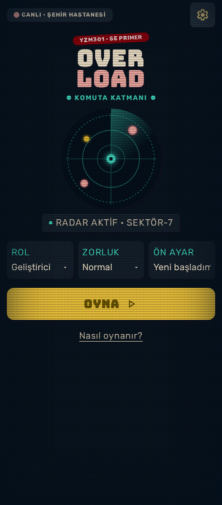
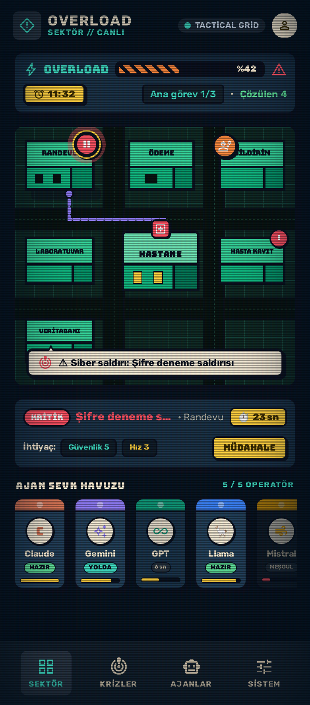
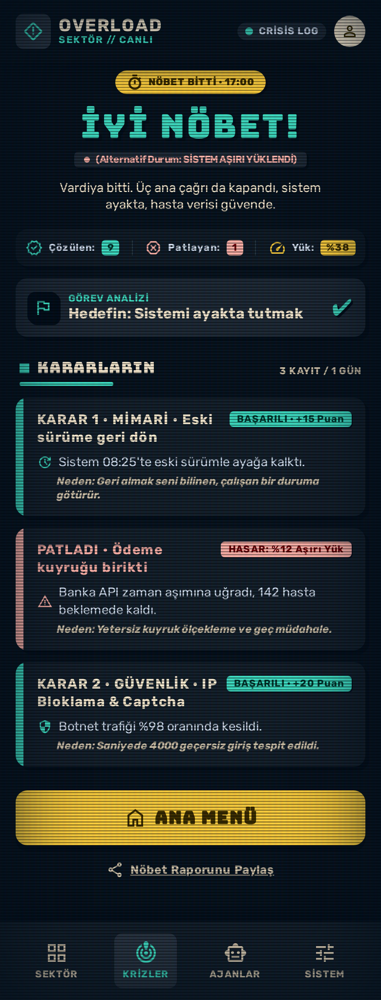

# Tasarım (Google Stitch)

**Stitch projesi:** *link eklenecek*

Ekranlar, [`../stitch/PROMPTS.md`](../stitch/PROMPTS.md) içindeki prompt ile aynı Stitch projesinde üretildi.

| Ekran | Stitch görseli | Stitch HTML çıktısı | Uygulamada |
|---|---|---|---|
| Genel görünüm + tasarım sistemi | [`00-stitch-overview.png`](00-stitch-overview.png) | [`DESIGN.stitch.md`](DESIGN.stitch.md) | [`../DESIGN.md`](../DESIGN.md) |
| 01 · Giriş (Ana Menü) | [`01-giris.png`](01-giris.png) | [`01-giris.stitch.html`](01-giris.stitch.html) | Ana menü (`play`) |
| 02 · Oyun Sahnesi (Harita) | [`02-sahne.png`](02-sahne.png) | [`02-sahne.stitch.html`](02-sahne.stitch.html) | Vardiya ekranı (`marker-*`, `agent-*`) |
| 03 · Bitiş Ekranı | [`03-son.png`](03-son.png) | [`03-son.stitch.html`](03-son.stitch.html) | Son ekranı (`end-title`) |

  

Ödev üç ekran istiyor: giriş, sahne, son. Stitch ayrıca **Overload Command Interface** tasarım sistemini üretti; kendi DESIGN.md'si [`DESIGN.stitch.md`](DESIGN.stitch.md) olarak duruyor.

Bu ekranlar ve spec, AI Studio'ya verildi; Gemini'nin ilk ürettiği React maketi süreç kanıtı olarak [`../aistudio/gemini-ilk-surum/`](../aistudio/gemini-ilk-surum/) klasöründe.

Kök dizindeki [`DESIGN.md`](../DESIGN.md), uygulamanın gerçekte kullandığı değerleri anlatır; Stitch'inkiyle yan yana durması, tasarımdan koda neyin değiştiğini gösterir.

## Tasarımdan koda: ne kaldı, ne değişti

**Kalanlar**
- Renk sistemi birebir aynı: birincil sarı `#FFD23F`, ikincil turkuaz `#3FE0C5`, üçüncül kırmızı `#FF5263`, nötr `#0F1C28`. Kırmızı yalnızca alarm için.
- Rubik başlık / gövde / etiket hiyerarşisi; logo için Bungee.
- Kalın kontur ve sert gölgeli kartlar, sarı birincil buton, "CANLI · ŞEHİR HASTANESİ" göstergesi, radar.
- Ekran sırası: HUD → harita → olay şeridi → ajan kartları.
- Ajan kartlarında renkli üst bant, yuvarlak logo, durum ve enerji çubuğu.
- Son ekranında başlık, istatistik satırı, hedef kutusu ve sol kenarı renkli karar kartları.

**Bilerek değiştirdiklerimiz ya da almadıklarımız**
- **Alt gezinme çubuğu** (Sektör / Krizler / Ajanlar / Sistem): almadık. Oyunun tek bir ekranı var ve her şey haritanın üstünde oluyor; sekmeler, telefonda harita için gereken dikey alanı yiyor ve vardiya sırasında oyuncuyu haritadan uzaklaştırıyordu.
- **Olay şeridindeki "MÜDAHALE" butonu:** almadık. Oyuncu zaten ajan kartına dokunarak gönderiyor; ikinci bir buton aynı işi yapan iki yol demekti.
- **Kararlarda "+15 puan" etiketleri:** almadık. Puan, oyuncunun doğru seçeneği "puan avcılığıyla" bulmasına yol açar ve cevabı söylemeyen tutor'un amacıyla çelişir. Sonucu Overload değişimi ve "Neden oldu?" açıklıyor.
- **"Nöbet raporunu paylaş":** almadık. Paylaşım hesap ya da dış servis gerektirir; ödevde kapsam dışı.
- **Harita:** Stitch haritayı düz kutular olarak çizdi. Uygulamada harita eğik kuş bakışı, canlı bir şehir: binaların hacmi var, ajanlar yollardan gider ve iz bırakır, işaretler zamanla büyür.
- **Stitch'in uydurduğu ayrıntılar:** son ekranında "Banka API zaman aşımı", "142 hasta" gibi senaryoda olmayan metinler vardı. Uygulamadaki metinler spec'teki senaryoya bağlı kaldı; tutor ve eval aynı olaylardan bahsediyor.
- **Karar penceresi ve tutor:** Stitch'te yoktu; uygulamada bir alt sayfa olarak eklendi (bkz. DESIGN.md › Bileşenler).

**Stitch'ten aldığımız fikirler**
- Son ekranında hedefin ayrı bir kutuda ✔ / ✘ ile gösterilmesi.
- HUD'da Overload barının çizgili dolgusu ve yüzdenin barın sağında durması.
