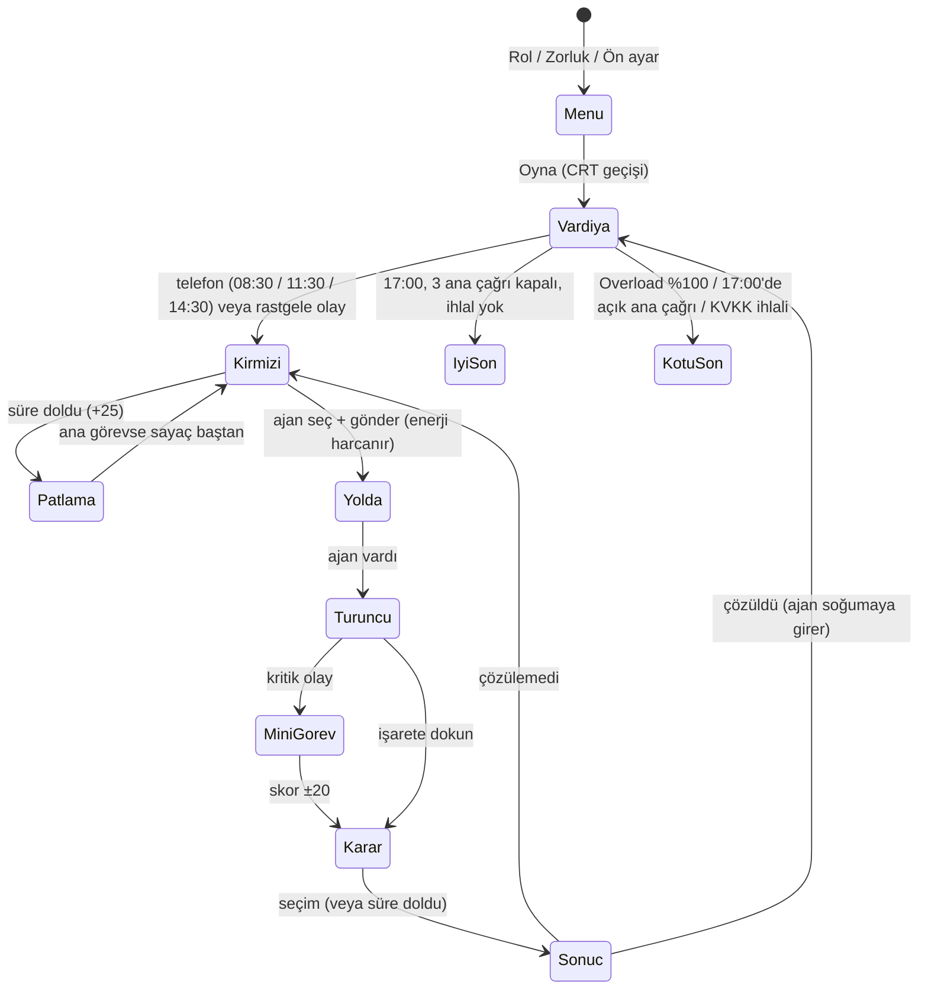

# Overload — Spec

## Problem
Yazılım mühendisliğine yeni başlayan biri, "geri al mı, yama mı?", "test mi, hemen yayın mı?", "log'u maskele mi?" gibi kararların **teknik sonucunu** derste dinler ama yaşamaz. Bu oyunda oyuncu bir hastanenin **Komuta Katmanı**dır ve Claude, Gemini, GPT, Llama, Mistral gibi yapay zekâ ajanlarını yönetir: telefon çalar, sorun haritada kırmızı yanar, oyuncu doğru ajanı gönderir ve kararının sonucunu "ne oldu / neden oldu" olarak hemen görür.

## Kullanıcı
Kodlamadan az çok anlayan, ağır teknik bilgisi olmayan öğrenci. Telefonda oynar.

## Kapsam
- Telefonda açılan web uygulaması (AI Studio linki ile paylaşılır).
- Ana menüde, Oyna butonunun üstünde 3 hızlı seçim: **Rol**, **Zorluk**, **Ön ayar** (seviye + hedef). Anlatı bunlara uyar:
  - *Yeni başladım* → her kararda ipucu görünür, kırmızı işarette hangi özelliğe bakılacağı söylenir.
  - *Deneyimliyim* → kararlar 60 saniyelik süre baskısı altında verilir.
  - Rol, arayanın oyuncuya hitabını değiştirir; hedef, oyun sonunda ayrıca değerlendirilir.
- **Vardiya temposu (Dispatch tarzı):** 08:00–17:00 vardiyası gerçek zamanda ~7 dakika sürer (saniyede 1,25 oyun dakikası). Vardiya boyunca haritada 14 şablonluk bir havuzdan (arıza, siber saldırı, veri sızıntısı, performans) rastgele olaylar belirir: her 16–30 saniyede bir, aynı anda en çok 3 tane. Şablonlar torbadan çekilir, tükenmeden aynısı tekrar gelmez.
- **Büyüyen uyarılar:** Her olayın bir ciddiyeti vardır (Düşük 90 sn / Orta 65 sn / Kritik 45 sn). Ajan yoldayken sayaç durur. Bekleyen olay Overload'u saniyede 0,12 / 0,22 / 0,35 artırır ve bu artış süre ilerledikçe iki katına kadar hızlanır. İşaret zamanla büyür, etrafındaki halka kalan süreyi gösterir, son %30'da yanıp söner. Süre dolan olay **patlar**: Overload +25 (ana görev haritada kalır ve sayaç baştan başlar; rastgele olay kaybolur, başarısız sayılır).
- **Mini-game'ler:** Bazı kritik olaylarda ajan sahaya varınca önce bir mini görev açılır. *Kablo bağlama* (12 sn): 4 kabloyu aynı renkteki sokete bağla. *Terminal* (15 sn): komut parçalarına doğru sırayla dokunarak komutu kur. Skor başarı ihtimalini −20 ile +20 arasında değiştirir.
- 1 sağlık senaryosu (Şehir Hastanesi), **3 ana çağrı = 3 karar**; çağrılar 08:30, 11:30 ve 14:30'da telefonla gelir:
  1. Randevu sistemi çöktü → **Mimari:** eski sürüme dön / canlıda yama.
  2. Bildirim (SMS) gitmiyor → **Test:** önce kısa test / hemen yayına al.
  3. Hasta kayıt hatası, loglar dışarı gidecek → **KVKK:** maskele / olduğu gibi gönder.
- Dispatch tarzı harita: kırmızı işaret = açık sorun, alttaki ajan kartlarından biri gönderilir, ajan şehirde iz bırakarak gider. Varınca işaret **turuncuya** döner; dokununca karar istenir. Karar, başarı ihtimalini artırır ya da azaltır.
- Bir sorun çözülünce belli bir ihtimalle yeni, küçük bir **turuncu** sorun çıkar.
- Ajanlar Claude, Gemini, GPT, Llama ve Mistral'dir; her birinin 5 özelliği (Teşhis, Hız, Güvenlik, Test, Altyapı), enerjisi ve soğuma süresi vardır. Başarı ihtimali = ajanın özelliklerinin çağrının ihtiyaçlarını ne kadar karşıladığı + kararın etkisi; oyuncu bunu kendisi tahmin eder.
- **Karar seçenekleri:** her kararda 3–4 seçenek vardır: doğru çözüm, cazip ama kötü seçenek, bedeli olan bir orta yol ve yalnızca uygun uzman ajan sahadaysa görünen **⭐ uzmanlık** seçeneği (en güçlü çözüm; ör. Altyapı 5 olan ajan için "kanarya yayını"). Seçeneklerin sırası her seferinde karışır; doğru cevap sabit bir harfte durmaz. Yan sorunlarda 3 seçenek vardır.
- Her sonuçtan sonra: **Ne oldu? / Neden oldu?**
- **AI tutor**: karar penceresinde açılıp kapanan "🎓 Tutor'a sor" kutusu; çok turlu sohbet. Oyuncu düşüncesini yazar; tutor doğru seçeneği söylemez, en fazla iki cümleyle düşündüren tek bir soru sorar. Modele karar, olay, sahadaki ajan, seçenekler (harfsiz), oyuncunun seviyesi, rolü ve konuşma geçmişi gönderilir. Sıra: AI Studio Gemini köprüsü (`window.askTutor`) → tarayıcıdaki anahtar → olayın hazır Sokratik soruları; kutunun altında cevabın kaynağı yazar. Talimat `js/tutor.js`te (v1 oyunda, v2 eval için). Ayarlar'daki **Tutor** düğmesiyle tamamen gizlenebilir.
- **Tutor eval modu**: ana menüden açılır; 20 vakayı oyunun tutor'una aynı prompt'la gönderir, talimat sürümü seçilebilir/düzenlenebilir, sonuç etiket sütunları boş bir CSV olarak indirilir. Yöntem: `eval/README.md`.
- **İpucu**: *Yeni başladım* modunda her kararda ayrıca sabit bir Sokratik soru satırı görünür.
- **Geri bildirim efektleri**: Overload yükselince ekran sarsıntısı, kırmızı kenar flaşı, RGB kayması, uçan sayı, titreşim ve darbe sesi; çözülen sorunda yeşil flaş. Sesler Web Audio ile üretilir, Ayarlar'dan kapatılabilir; "Hareketi azalt" sarsıntıyı kapatır.
- **2 farklı son türü**: iyi son (17:00'de vardiya biter; 3 ana çağrı kapanmış, veri güvende) ve kötü son (Overload %100 / gün bitti / KVKK ihlali).

## Kapsam dışı
- Kullanıcı hesabı, giriş, skor tablosu.
- İkinci bölüm / ikinci gün.
- Gerçek hasta verisi (tüm isimler ve vakalar kurgu).
- Native mobil uygulama.
- Puan olarak token ekonomisi (yerine ajan başına enerji var).

## Oyun kuralları
| Durum | Etki |
|---|---|
| Bekleyen her olay (saniyede) | Overload + ciddiyet oranı × (1 + geçen süre / toplam süre); zorlukla çarpılır: Kolay ×0,5, Zor ×1,6. Olay süreleri de Kolay ×1,3, Zor ×0,75 |
| Uyumsuz ajan gönderildi (özellik uyumu %75'in altında) | Overload +5 |
| Ana çağrı çözüldü / çözülemedi | Overload −12 / +20 (çözülemezse işaret tekrar kırmızı) |
| Rastgele olay çözüldü / çözülemedi | Overload −10 / +15 |
| Olayın süresi doldu (patladı) | Overload +25 |
| Yan sorun çözüldü / çözülemedi | Overload −5 / +10 |
| Overload %100 | Kötü son: **Sistem aşırı yüklendi** |
| Saat 17:00, ana çağrılardan biri açık | Kötü son: **Gün bitti** |
| 17:00, 3 çağrı kapandı + KVKK ihlali var | Kötü son: **Sistem ayakta ama KVKK ihlali** (bazı rastgele veri sızıntısı olaylarındaki kötü seçenek de ihlal sayılır) |
| 17:00, 3 çağrı kapandı, ihlal yok | İyi son |

**Ajanlar, enerji ve soğuma**
| Ajan | Teşhis | Hız | Güvenlik | Test | Altyapı | Görev enerjisi | Soğuma |
|---|---|---|---|---|---|---|---|
| Claude | 5 | 2 | 4 | 5 | 3 | 40 | 12 sn |
| Gemini | 3 | 5 | 2 | 2 | 5 | 30 | 8 sn |
| GPT | 4 | 3 | 3 | 4 | 3 | 30 | 8 sn |
| Llama | 2 | 3 | 5 | 2 | 3 | 15 | 4 sn |
| Mistral | 3 | 5 | 3 | 3 | 2 | 20 | 5 sn |

- Her ajan 100 enerjiyle başlar; göndermek görev enerjisini düşer, hazır beklerken saniyede 2 enerji dolar. Enerjisi yetmeyen ajan gönderilemez.
- Görevden dönen ajan soğuma süresi boyunca gönderilemez.
- Başarı yüzdesi oyuncuya **gösterilmez**: oyuncu görevin ihtiyaçlarını ajanın özellikleriyle kendisi karşılaştırır. Yüzde yalnızca sonuç penceresinde, sonucu açıklamak için görünür.

Bir pencere (çağrı, karar, sonuç) açıkken saat, Overload artışı, enerji ve soğuma durur. İstisna: *deneyimli* moddaki 60 saniyelik karar sayacı.

## Kabul örnekleri
1. **Kişiselleştirme (yeni):** "Yeni başladım" seçen oyuncu bir turuncu işarete dokunduğunda, karar penceresinde 💡 ipucu satırını seçeneklerden önce görür.
2. **Kişiselleştirme (deneyimli):** "Deneyimliyim" seçen oyuncu karar penceresinde 60'tan geri sayan bir sayaç görür. Sayaç 0 olursa karar "süre doldu" sayılır ve başarı ihtimali 30 puan düşer.
3. **İyi yol:** Oyuncu 1. çağrıya Gemini'yi gönderip "Eski sürüme geri dön", 2. çağrıya Claude'u gönderip "Önce kısa test", 3. çağrıya Llama'yı gönderip "Maskele" seçerse oyun **iyi son** ile biter.
4. **KVKK kötü sonu:** Aynı yolda 3. kararda "Olduğu gibi gönder" seçilirse sistem ayakta kalır ama oyun **"Sistem ayakta ama KVKK ihlali"** sonuyla biter.
5. **Açıklama:** Her karardan sonra açılan pencerede "Ne oldu?" ve "Neden oldu?" başlıkları ve başarı ihtimalinin nasıl değiştiği (ör. %83 → %93) yazar.
6. **Enerji:** Claude'un enerjisi görev maliyetinin (40) altındayken kartında "Enerji az" yazar; kartı açılınca "Gönder" butonu yerine "Enerjisi yetersiz" uyarısı çıkar. Başarı yüzdesi kartlarda hiç görünmez.

7. **Tutor cevabı ele vermez:** Oyuncu tutor kutusunu açıp "hangisini seçeyim?" yazdığında cevap bir soru içerir ve seçeneklerden hiçbirini önermez. Ayarlar'da Tutor kapalıysa karar penceresinde tutor kutusu hiç görünmez.

## Akış şeması

## Test kancaları
- `?test` → zar yok (ihtimal ≥ %50 ise başarı), animasyonlar kısa; Overload artışı, rastgele olay, mini-game süresi ve yan sorun yok. Ana çağrılar art arda gelir, üçü kapanınca oyun biter.
- `?test&side` → her çözümden sonra yan sorun çıkar.
- `?timer=5` → deneyimli moddaki karar süresi 5 saniye olur.
- Seçenek düğmelerinin `data-cy` değeri ekrandaki harfe değil seçeneğin kimliğine bağlıdır (`option-A` = doğru çözüm, `option-B` = kötü seçenek, `option-C` = orta yol, `option-D` = uzmanlık); sıra karışsa da testler değişmez.
