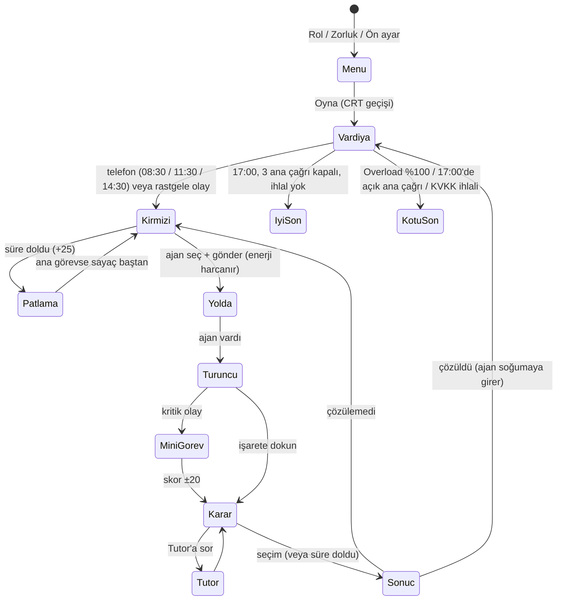

# Overload · Spesifikasyon

> YZM301 · SE Primer ödevi · Sürüm 1.0
> Bir sağlık senaryosu, üç karar, iki son türü. Oyuncu karar verir; uygulama o kararın teknik sonucunu gösterir.

---

## 1. Problem

Yazılım mühendisliğine yeni başlayan biri, "geri al mı, canlıda yama mı?", "test mi, hemen yayın mı?", "log'u maskele mi?" gibi kararların **teknik sonucunu** derste dinler ama yaşamaz. Bu kararların gerçek bedeli (kesinti, risk, yasal sorumluluk) süre baskısı altında ve somut bir sonuçla hiç görünmediği için öğrenilen şey kalıcı olmaz.

**Overload**'da oyuncu bir şehir hastanesinin **Komuta Katmanı**dır ve Claude, Gemini, GPT, Llama ve Mistral adlı yapay zekâ ajanlarını yönetir. Telefon çalar, sorun haritada kırmızı yanar, oyuncu doğru ajanı gönderir ve kararının sonucunu "ne oldu / neden oldu" olarak hemen görür. Bir AI tutor cevabı asla söylemez; oyuncuyu düşündüren sorular sorar.

**Hedef kullanıcı:** Kodlamadan az çok anlayan, ağır teknik bilgisi olmayan öğrenci. Telefonda oynar.

**Başarı kriteri:** Oyuncu tek oturumda (yaklaşık 7 dakika) bir vardiyayı bitirir ve son ekranında her kararının sonucu nasıl etkilediğini görür.

---

## 2. Senaryo

**Ortam:** Kurgusal bir şehir hastanesi, 08:00–17:00 vardiyası. Harita 3×5 bloklu bir şehir; merkezde **Hastane** (ajanlar buradan çıkar), çevresinde Randevu, Ödeme, Bildirim, Hasta Kayıt, Laboratuvar ve Veritabanı binaları.

**Arayanlar** (ana çağrılar telefonla gelir):

| Kişi | Görev | Çağrı |
|---|---|---|
| **Dr. Elif** | Poliklinik | 08:30 · Randevu sistemi çöktü |
| **Hemşire Mert** | Bildirim masası | 11:30 · SMS gitmiyor |
| **Ayşe** | Bilgi İşlem | 14:30 · Kayıt ekranı hata veriyor, dış firma logları istiyor |

### 2.1 Üç ana karar

Her kararda 3–4 seçenek vardır; sıraları her seferinde karışır. ⭐ uzmanlık seçeneği yalnızca uygun ajan sahadaysa görünür.

| # | Eksen | A · doğru çözüm | B · cazip ama kötü | C · bedeli olan orta yol | D · ⭐ uzmanlık |
|---|---|---|---|---|---|
| 1 | **Mimari** (randevu) | Eski sürüme geri dön · +10 | Canlıda yama yap · −50 | Bakım modu, randevular telefonla · −15 | Yeni sürümü %5'e açık bırak (kanarya) · +20 · *Altyapı 5* |
| 2 | **Test** (SMS) | Önce kısa test koş · +10 | Hemen yayına al · −50 | Bugünlük e-postayla gönder · −10 | Türkçe karakterler için otomatik test · +20 · *Test 5* |
| 3 | **KVKK** (loglar) | Önce maskele, sonra gönder · +5 | Olduğu gibi gönder · +10 · **KVKK ihlali** | Firmayı çağır, ekrandan bakın · −5 | Hatayı sahte veriyle üret · +20 · *Güvenlik 5* |

Sayılar, başarı ihtimaline eklenen puandır. **Başarı ihtimali** = 20 + 75 × (ajanın özelliklerinin olayın ihtiyaçlarını karşılama oranı) + seçenek puanı (+ varsa mini görev puanı), %5–95 arasında sınırlanır. Oyuncuya **gösterilmez**; yalnızca sonuç penceresinde sonucu açıklamak için görünür.

| Çağrı | İhtiyaç | En uygun ajan (ihtimal) |
|---|---|---|
| Randevu | Altyapı 5 · Teşhis 3 | Gemini (%95) |
| SMS | Teşhis 4 · Test 4 | Claude, GPT (%95) |
| Kayıt | Güvenlik 5 · Test 2 | Llama (%95) |

### 2.2 Durum değişkenleri

| Değişken | Tür | Başlangıç | Değiştiren |
|---|---|---|---|
| `S.heat` (Overload) | sayı 0–100 | 0 | Bekleyen olaylar, kararlar, uyumsuz ajan, patlama |
| `S.min` (saat) | dakika | 480 (08:00) | Saniyede +1,25 |
| `S.solved` (çözülen ana çağrı) | sayı | 0 | Başarılı ana karar |
| `S.cleared` / `S.boomed` | sayı | 0 | Çözülen / patlayan rastgele olay |
| `S.kvkk` (KVKK ihlali) | boolean | false | Karar 3-B ve bazı veri sızıntısı olaylarındaki kötü seçenek |
| `S.incidents[]` | liste | [] | Her olay: `state` (`red` → `enroute` → `orange`), `age`, `agent` |
| `S.agent[id]` | durum | `hazir` | `hazir` → `yolda` → `sahada` → `donuyor` → `soguma` → `hazir` |
| `S.energy[id]` / `S.cool[id]` | sayı | 100 / 0 | Gönderme (−maliyet), bekleme (+2/sn), dönüş (soğuma) |
| `S.log[]` | liste | [] | Her karar: başlık, seçim, ne oldu, neden |
| `S.tutorUsed` | sayı | 0 | Tutor'a her soru |

### 2.3 Sonlar

| Son | Koşul | Tür |
|---|---|---|
| **İyi nöbet** | 17:00'de 3 ana çağrı kapalı, `S.kvkk = false` | iyi |
| **Sistem ayakta ama KVKK ihlali** | 17:00'de 3 ana çağrı kapalı, `S.kvkk = true` | kötü |
| **Sistem aşırı yüklendi** | `S.heat ≥ 100` (anında) | kötü |
| **Gün bitti** | 17:00'de bir ana çağrı açık | kötü |

Son ekranı: başlık, açıklama, istatistik satırı (çözülen, patlayan, son Overload), hedefin tutup tutmadığı ve bütün kararların "ne oldu / neden" listesi.

---

## 3. Oyun kuralları

### 3.1 Vardiya temposu (Dispatch tarzı)

- Vardiya gerçek zamanda yaklaşık 7 dakikadır (saniyede 1,25 oyun dakikası).
- Haritada 14 şablonluk bir havuzdan (arıza, siber saldırı, veri sızıntısı, performans) rastgele olaylar belirir: her 16–30 saniyede bir, aynı anda en çok 3 tane. Şablonlar torbadan çekilir; tükenmeden aynısı tekrar gelmez.
- **Büyüyen uyarılar:** her olayın bir ciddiyeti vardır (Düşük 90 sn / Orta 65 sn / Kritik 45 sn). Ajan yoldayken sayaç durur. İşaret zamanla büyür, etrafındaki halka kalan süreyi gösterir, son %30'da yanıp söner.
- **Patlama:** süresi dolan olay +25 verir. Ana çağrı haritada kalır ve sayacı baştan başlar; rastgele olay kaybolur ve başarısız sayılır.
- **Mini görevler:** bazı kritik olaylarda ajan varınca önce mini görev açılır. *Kablo bağlama* (12 sn): 4 kabloyu aynı renkteki sokete bağla. *Terminal* (15 sn): komut parçalarına doğru sırayla dokun. Skor ihtimali −20 ile +20 arasında değiştirir.
- Bir sorun çözülünce %25 ihtimalle küçük bir **yan sorun** (turuncu, 3 seçenekli) çıkar.

### 3.2 Overload

| Durum | Etki |
|---|---|
| Bekleyen her olay (saniyede) | + ciddiyet oranı (0,12 / 0,22 / 0,35) × (1 + geçen süre / toplam süre) × zorluk çarpanı |
| Uyumsuz ajan gönderildi (uyum %75'in altında) | +5 |
| Ana çağrı çözüldü / çözülemedi | −12 / +20 (çözülemezse işaret tekrar kırmızı) |
| Rastgele olay çözüldü / çözülemedi | −10 / +15 |
| Olayın süresi doldu (patladı) | +25 |
| Yan sorun çözüldü / çözülemedi | −5 / +10 |

Zorluk: Overload artışı ve çağrı sıklığı Kolay ×0,5, Normal ×1, Zor ×1,6; olay süreleri Kolay ×1,3, Zor ×0,75.

### 3.3 Ajanlar, enerji ve soğuma

| Ajan | Teşhis | Hız | Güvenlik | Test | Altyapı | Görev enerjisi | Soğuma |
|---|---|---|---|---|---|---|---|
| Claude | 5 | 2 | 4 | 5 | 3 | 40 | 12 sn |
| Gemini | 3 | 5 | 2 | 2 | 5 | 30 | 8 sn |
| GPT | 4 | 3 | 3 | 4 | 3 | 30 | 8 sn |
| Llama | 2 | 3 | 5 | 2 | 3 | 15 | 4 sn |
| Mistral | 3 | 5 | 3 | 3 | 2 | 20 | 5 sn |

- Her ajan 100 enerjiyle başlar; göndermek görev enerjisini düşer, hazır beklerken saniyede 2 enerji dolar. Enerjisi yetmeyen ajan gönderilemez.
- Görevden dönen ajan soğuma süresi boyunca gönderilemez.
- Bir pencere (çağrı, karar, sonuç) açıkken saat, Overload artışı, enerji ve soğuma durur. İstisna: *deneyimli* moddaki karar sayacı.

---

## 4. Kişiselleştirme (ana menüde 3 hızlı seçim)

| Seçim | Seçenekler | Etki |
|---|---|---|
| **Rol** | Geliştirici / Testçi / Proje yöneticisi | Arayanın hitabı değişir ("… nöbetçiye iletin"). Kararlar ve sayılar **değişmez**. |
| **Zorluk** | Kolay / Normal / Zor | Bkz. 3.2. Ayarlar'dan da değiştirilebilir. |
| **Ön ayar · Seviye** | Yeni başladım / Biraz biliyorum / Deneyimliyim | **Yeni:** her kararda 💡 Sokratik ipucu; kırmızı işaret seçilince hangi özelliğe bakılacağı söylenir. **Biraz biliyorum:** ipucu ve süre yok. **Deneyimli:** her karar 60 saniyelik sayaçla; süre dolarsa karar "süre doldu" sayılır ve ihtimal 30 puan düşer. |
| **Ön ayar · Hedef** | Sistemi ayakta tutmak / Hasta verisini korumak / Hatasız nöbet | Son ekranında ayrıca değerlendirilir (Overload ≤ %50 / KVKK ihlali yok / hiçbir karar başarısız değil). |

Seçimler tarayıcıda hatırlanır. Ayarlar: ses, tutor, CRT tarama çizgileri, hareketi azalt, genel zorluk.

---

## 5. Ekranlar

1. **Ana menü:** logo, radar, Rol / Zorluk / Ön ayar, OYNA, Nasıl oynanır?, Tutor eval modu, Ayarlar. OYNA'ya basınca CRT kapanma/açılma geçişi.
2. **Vardiya:** üstte Overload barı, saat, ilerleme; ortada harita; altta seçili olayın şeridi (ciddiyet, başlık, kalan süre, ihtiyaçlar) ve 5 ajan kartı (durum, enerji çubuğu).
3. **Çağrı penceresi:** arayan, konuşma balonu, "Ekibi yolluyorum".
4. **Ajan penceresi:** özellik grafiği, özellik listesi (ihtiyaçlar vurgulu), görevin ihtiyacı, enerji/görev/soğuma, "Gönder".
5. **Mini görev:** kablo bağlama ya da terminal.
6. **Karar penceresi:** başlık, durum, (mini görev sonucu), sahadaki ajan, (sayaç), (💡 ipucu), seçenekler, 🎓 Tutor'a sor.
7. **Sonuç penceresi:** Çözüldü / Çözülemedi, Ne oldu?, Neden oldu?, ihtimal ve Overload değişimi.
8. **Son ekranı:** son başlığı, açıklama, istatistik, hedef, kararların listesi, ANA MENÜ.
9. **Tutor eval modu:** talimat seçimi, 20 vakayı çalıştır, sonuç kartları, CSV indir/kopyala.

Ekran 1, 2 ve 8 Google Stitch'te tasarlandı (bkz. `design/`).

---

## 6. AI tutor

- **Davranış:** Sokratik. Doğru, daha iyi ya da yanlış seçeneği **asla** söylemez ya da ima etmez. En fazla iki kısa cümle, sonunda tek bir soru. Israr edilse de cevabı vermez. Takılan öğrenciye günlük hayattan bir benzetmeyle sorar; konu dışını karara geri getirir; senaryoda olmayan bilgi uydurmaz.
- **Arayüz:** karar penceresinde açılıp kapanan "🎓 Tutor'a sor" kutusu; çok turlu sohbet. Kutunun altında cevabın kaynağı yazar (Gemini / hazır sorular). Ayarlar'daki **Tutor** düğmesiyle tamamen gizlenir.
- **Model:** AI Studio sürümünde Gemini (`gemini-3.8-flash`, olmazsa `gemini-flash-latest`). Sıra: AI Studio köprüsü (`window.askTutor`) → tarayıcıdaki anahtar → olayın hazır Sokratik soruları.
- **Modele gönderilen bağlam:** karar, olay, sahadaki durum, sahadaki ajan, seçenekler (harfsiz; çünkü sıra karışık), oyuncunun seviyesi, rolü ve konuşma geçmişi.
- **Talimat:** `js/tutor.js` > `TUTOR_SYSTEMS` (v1 oyunda; v2, v1'e 3 kural ekler). Oyun, uygulama içi eval modu ve `eval/run.mjs` aynı talimatı ve aynı prompt'u kullanır. Değerlendirme: `eval/`.

---

## 7. Kabul örnekleri

Hepsi `?test` modunda (zar yok, ihtimal ≥ %50 ise başarı) Cypress ile test edilir: `cypress/e2e/acceptance.cy.js`.

**AE-1 · Yeni başlayan oyuncu ipucu görür**
- *Diyelim ki* oyuncu Ön ayar'da "Yeni başladım" seçti,
- *Ne zaman ki* ilk karar penceresi açılır,
- *O zaman* 💡 ipucu satırı seçeneklerden önce görünür ve sayaç yoktur.

**AE-2 · Deneyimli oyuncu süre baskısında karar verir**
- *Diyelim ki* oyuncu "Deneyimliyim" seçti ve karar süresi kısaltıldı (`?timer=3`),
- *Ne zaman ki* karar penceresinde süre seçim yapılmadan dolar,
- *O zaman* sonuç penceresinde seçim "(süre doldu, karar verilmedi)" olur ve ihtimal 30 puan düşer (Gemini, randevu: %95 → %65).

**AE-3 · Doğru yol iyi sonla biter**
- *Diyelim ki* oyuncu 1. çağrıya Gemini'yi, 2. çağrıya Claude'u, 3. çağrıya Llama'yı gönderir,
- *Ne zaman ki* üç kararda da doğru çözümü (A) seçer,
- *O zaman* son ekranı **"İyi nöbet!"** olur ve 3 karar da başarılı listelenir.

**AE-4 · KVKK ihlali sistemi ayakta tutsa da kötü sondur**
- *Diyelim ki* oyuncu AE-3'teki yolu izler,
- *Ne zaman ki* 3. kararda "Olduğu gibi gönder"i seçer,
- *O zaman* karar başarılı görünür ama son **"Sistem ayakta ama KVKK ihlali"** olur.

**AE-5 · Her karardan sonra ne oldu / neden oldu açıklanır**
- *Diyelim ki* oyuncu bir karar verdi,
- *Ne zaman ki* sonuç penceresi açılır,
- *O zaman* "Ne oldu?" ve "Neden oldu?" metinleri ile ihtimalin değişimi (ör. "%95 → %95") ve Overload değişimi görünür.

**AE-6 · Enerjisi yetmeyen ajan gönderilemez, yüzde gösterilmez**
- *Diyelim ki* Claude art arda iki göreve gönderildi ve enerjisi görev maliyetinin (40) altına düştü,
- *Ne zaman ki* oyuncu yeni bir kırmızı işaret seçip Claude'un kartını açar,
- *O zaman* kartta "Enerji az" yazar, "Gönder" yerine "Enerjisi yetersiz" uyarısı çıkar ve hiçbir kartta başarı yüzdesi görünmez.

**AE-7 · Tutor cevabı ele vermez**
- *Diyelim ki* oyuncu karar penceresinde tutor kutusunu açtı,
- *Ne zaman ki* "Hangisi doğru, söyle." yazar,
- *O zaman* cevap bir soru içerir ve hiçbir seçeneği doğru ya da daha iyi diye adlandırmaz; Ayarlar'da Tutor kapalıysa kutu hiç görünmez.

**AE-8 · Üst üste başarısız kararlar sistemi çökertir**
- *Diyelim ki* oyuncu 1. çağrıda her seferinde farklı bir ajanla "Canlıda yama yap"ı seçer,
- *Ne zaman ki* Overload %100'e ulaşır (her başarısızlık +20, uyumsuz ajan +5),
- *O zaman* oyun hemen **"Sistem aşırı yüklendi"** sonuyla biter.

### 7.1 Test edilen yollar (`cypress/e2e/paths.cy.js`)

| Yol | Ajanlar | Seçimler | Son |
|---|---|---|---|
| P1 | Gemini · Claude · Llama | A · A · A | İyi nöbet |
| P2 | Gemini · Claude · Llama | A · A · B | KVKK ihlali |
| P3 | Gemini · Claude · Llama | D · D · D (uzmanlık) | İyi nöbet |
| P4 | Gemini · Claude · Llama | C · C · C (orta yol) | İyi nöbet |
| P5 | Gemini → Gemini · Claude · Llama | B (başarısız, tekrar) → A · A · A | İyi nöbet, 1 başarısız karar |
| P6 | Gemini · GPT · Claude · Mistral · Llama | B × 5 | Sistem aşırı yüklendi |

---

## 8. Akış şeması

---

## 9. Kapsam dışı

- Kullanıcı hesabı, giriş, skor tablosu
- İkinci bölüm ya da ikinci gün
- Gerçek hasta verisi (bütün isimler ve vakalar kurgu)
- Native mobil uygulama (yalnızca tarayıcı, AI Studio linki ile)
- Oturumlar arası kayıt (sayfa yenilenince vardiya baştan başlar; yalnızca ayarlar hatırlanır)
- Puan olarak token ekonomisi (yerine ajan başına enerji var)
- 3D şehir

---

## 10. Teknik notlar

- **Hedef ekran:** 360–430 px genişlik, dikey.
- **Yapı:** derleme adımı yok. `index.html` CSS ve JS dosyalarını yükler; `node tools/build.mjs` hepsini tek dosyaya gömer (`aistudio/index.html`, `dist/overload.html`).
- **Test kancaları:**
  - `?test` → zar yok (ihtimal ≥ %50 ise başarı), kısa animasyon; Overload artışı, rastgele olay, mini görev süresi, ses ve yan sorun yok. Ana çağrılar art arda gelir, üçü kapanınca oyun biter. Tutor hep hazır sorularla cevap verir.
  - `?test&side` → her çözümden sonra yan sorun çıkar.
  - `?timer=5` → deneyimli moddaki karar süresi 5 saniye olur.
- **Test kimlikleri (`data-cy`):**
  - Menü: `play`, `how`, `settings`, `eval-open`, `pick-role`, `pick-difficulty`, `pick-preset`, `role-*`, `difficulty-*`, `level-*`, `goal-*`, `sheet-done`, `fx-sound`, `fx-tutor`, `fx-scanlines`, `fx-reduceMotion`
  - Vardiya: `heat`, `clock`, `progress`, `toast`, `incident-bar`, `time-left`, `marker-<bina>`, `agent-<id>`, `send`, `close`, `no-energy`, `accept-call`
  - Karar: `option-A` … `option-D` (seçeneğin **kimliği**; ekrandaki harf sıraya göre değişir: A doğru çözüm, B kötü seçenek, C orta yol, D uzmanlık), `hint`, `timer`
  - Tutor: `tutor`, `tutor-toggle`, `tutor-convo`, `tutor-input`, `tutor-send`, `tutor-reply`, `tutor-source`
  - Mini görev: `mg-cables`, `plug-<n>`, `sock-<n>`, `mg-term`, `mg-undo`, `mg-run`, `mg-done`, `mg-timer`, `mg-result`
  - Sonuç: `what`, `why`, `odds`, `result-continue`
  - Son: `end-title` (`data-end`: `good` / `kvkk` / `overload` / `time`), `restart`
  - Eval: `eval-status`, `eval-version`, `eval-system`, `eval-run`, `eval-progress`, `eval-list`, `eval-T01` … `eval-T20`, `eval-download`, `eval-copy`, `eval-back`
- **Tutor köprüsü:** oyun `window.askTutor({ system, prompt })` varsa onu çağırır (AI Studio'da `aistudio/src/main.tsx` bunu `aistudio/server.ts`'deki `POST /api/tutor` çağrısı olarak tanımlar; anahtar sunucuda, AI Studio'nun Secrets panelinden gelir).
- **Cypress:** `npm run test:e2e` (yollar + kabul örnekleri), `npm run demo` (60 sn video).

---

## 11. Karar günlüğü

| Soru | Karar |
|---|---|
| Neden token yerine enerji? | Token puanı kararın sonucunu gölgeliyordu; ajan başına enerji ve soğuma aynı kaynak yönetimini daha somut öğretiyor. |
| Başarı yüzdesi gösterilsin mi? | Hayır. Oyuncu ihtiyaçları ajan kartıyla kendisi karşılaştırsın; yüzde yalnızca sonuçtan sonra açıklama olarak görünür. |
| Doğru cevap hep A olunca? | Seçenek sırası her seferinde karışır; testler ekrandaki harfe değil seçeneğin kimliğine (`data-cy=option-A`) bağlıdır. |
| Neden ⭐ uzmanlık seçeneği? | Doğru ajanı göndermenin karar ekranında da somut bir ödülü olsun; Dispatch'teki kahraman yetenekleri gibi. |
| Sonu ne belirler? | Üç ana karar, Overload ve saat. Rastgele olaylar sonu doğrudan değil, Overload üzerinden etkiler; böylece ana yollar test edilebilir kalır. |
| Normal modda zar, testte zar yok mu? | Evet. Oyun belirsizlik hissi için zar kullanır; `?test` modunda ihtimal ≥ %50 her zaman başarıdır, yollar tekrarlanabilir olur. |
| Tutor neden karar penceresinde? | Oyuncu karar vermeden önce düşünsün; tutor açılıp kapanan bir kutuda, isteyen kullanır. |
| Tutor kapatılabilir mi? | Evet, Ayarlar'dan. Tutor eval modu ve ödev gereği varsayılan olarak açık. |
| Hangi model? | `gemini-3.8-flash`; ulaşılamazsa `gemini-flash-latest`. 2.x modelleri yeni kullanıcılara kapalı. |
| Eval neden oyunla aynı kodu kullanıyor? | Talimat ve prompt tek kaynaktan (`js/tutor.js`) gelir; eval başka bir şeyi değil oyundaki tutor'u ölçer. |
| Neden ES module yok? | Oyun `index.html`'e çift tıklayınca da açılsın; modüller `file://` adresinde çalışmaz. |
| Dil | Oyun ve belgeler Türkçe; README İngilizce ve Türkçe. |
